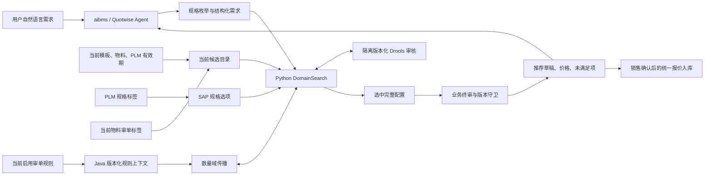
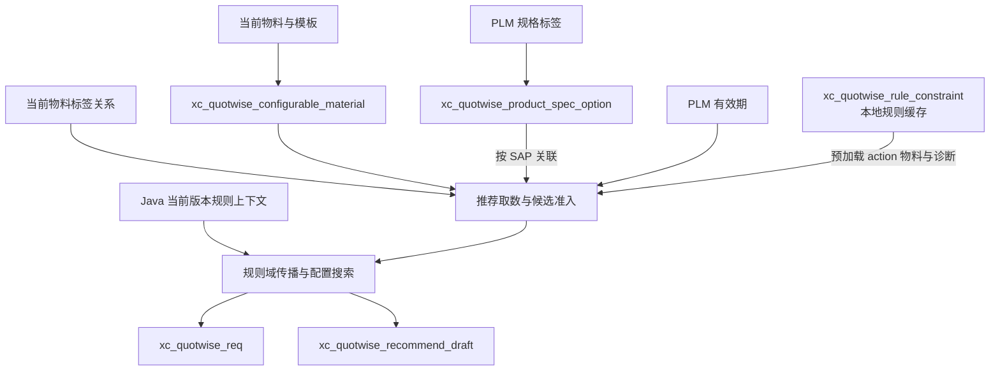
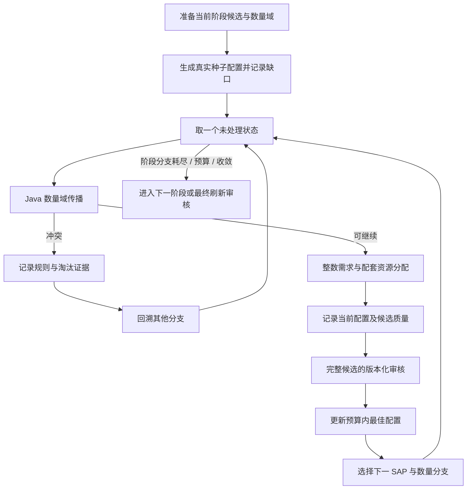

# 智能报价数据治理、规则求解与配置推荐实现说明

## 文档定位

本文依据截至 **2026-10-14** 工作区中的实际代码，说明 `xc_quotwise`、Java 审单系统 `xc-audit` 以及 aibms 展示与排查入口共同构成的智能报价方案。文档覆盖以下能力：

1. **当前数据治理**：把当前机型模板、有效物料、SAP 规格选项、真实审单标签和规则同步缓存组织为可计算输入。
2. **规则正推与配置搜索**：由 Java 提供带版本的规则上下文与数量域传播，Python 在有限预算内搜索整件物料组合并分配需求资源。
3. **完整配置审单**：搜索中执行隔离的版本化 Drools 审核，选定配置再经过原有 `/rule/doTest` 业务终审及前后规则版本检查。
4. **报价草稿与业务衔接**：保存结构化需求、推荐草稿、未满足项和求解证据，再通过价格、调整、审单、销售确认与统一报价入库服务完成业务流程。

当前生产推荐的依据是**当前物料、当前结构化规格、真实审单标签和当前审单规则**。规则求解、需求资源分配与完整配置审单共同决定推荐结果。

本文聚焦当前生产推荐的执行路径、数据依赖和接口契约，以实际调用代码为准。实施环境应具备相应数据模型、目录数据、规格数据及 Java 规则接口。

---

## 引言：为什么采用规则求解

### 1. 当前业务问题

智能报价要生成一套能满足需求且可以审单的配置，问题具有以下特点：

- 用户同时提出机型、单件规格、单台数量、整机台数、配套能力、服务和合规条款。
- 同一二级分类可以有多个独立需求组，例如 6 块 `960GB` SSD 与 16 块 `3.84TB` SSD。
- 当前模板限定机型可选分类和物料；物料状态、PLM 有效期和规格会随业务维护变化。
- 审单规则按标签数量、SAP 种类、条件依赖和 action 带出物料约束完整配置。
- 一件物料可以拥有多个真实标签，一项需求也可能需要主件与配套件共同证明。
- 找到某个规格相似物料，不等于找到可行整机；规则传播暂时没有冲突，也不等于完整配置通过终审。

配置合法性需要在当前物料范围和当前规则版本下求解。推荐问题是“在当前候选目录中，为每个 SAP 确定非负整数数量，并同时满足需求分配和业务规则”。

### 2. 方案目标

当前实现的目标可以分为四层：

| 层次 | 要解决的问题 | 实现依据 |
|---|---|---|
| 候选真实性 | 现在有哪些真实且有效的物料可以选 | 当前模板目录、`xc_material`、PLM 有效期、真实标签 |
| 需求匹配 | 物料能否证明用户提出的规格与数量 | SAP 结构化规格、当前规格原文、独立需求组和资源分配 |
| 组合合法性 | 哪些组合满足当前审单条件与带出义务 | Java 规则快照、数量域传播、隔离 Drools 审核、业务终审 |
| 结果可解释性 | 为什么选它、哪里偏离、哪些条款还未验证 | 规格证据、规则义务、淘汰原因、资源计算、状态字段与调试图 |

搜索在给定时间和状态预算内保留最佳真实配置。没有全部满足需求时，也可以输出待确认配置及缺口；没有真实物料时返回空结果，不生成虚构 SAP。实现不宣称证明全局最优，也不把搜索预算耗尽解释为已经证明无解。

### 3. 推荐结果的业务价值

- 为同分类多规格需求保留独立分组、数量与资源计算。
- 从当前目录中选择真实有效物料，并按当前规则补齐配套件。
- 在有限预算内寻找满足程度更高、偏离更少的完整配置。
- 对规格证据不足、数量调整、料号替代和服务条款给出明确说明。
- 用规则版本、完整审核和求解证据追踪每次推荐。
- 分别报告配置生成、需求满足、审单通过和是否需要确认。

### 4. 总体架构



---

# 第一部分：数据治理的实现

## 1. 治理原则

### 1.1 当前目录、规格、标签和规则各自有明确职责

| 数据维度 | 回答的问题 | 使用边界 |
|---|---|---|
| 机型模板与目录 | 哪些分类、哪些 SAP 属于当前可配置范围 | 普通候选入口；目录有效并不自动证明物料现在有效 |
| 当前物料与 PLM | 这个 SAP 是否存在、启用、未删除、未过期 | 普通物料与规则 action 物料都必须校验 |
| SAP 规格选项 | 这个 SAP 有哪些结构化规格 | 按真实 SAP 关联；不能从其他 SAP 借规格 |
| 真实审单标签 | 物料对哪些规则数量、种类计数有贡献 | 规则侧语义；不能用报价分类虚构标签 |
| Java 规则上下文 | 当前机型执行哪些规则、规则是什么版本 | 求解和版本化审核的权威规则来源 |
| 本地规则同步缓存 | 已同步规则的解析状态、动作 SAP 和治理诊断 | 为物料预加载及排查提供信息；不能替代 Java 当前版本 |

一个 SAP 属于“其它”分类但物料名称为“高速线缆”时，草稿中 `mat_type` 使用目录分类，`mat_name` 使用当前物料名称。分类、名称、结构化规格和审单标签不能互相覆盖。

### 1.2 分类与标签保持两个维度

二级分类决定报价 BOM 的结构位置和前端分组；真实标签决定规则中的业务能力与计数。例如“电源和电源线”分类下可以有电源和电源线，不代表每个 SAP 都同时具备两个标签。

当前推荐直接读取 `xc_material_xc_material_label_rel` 与 `xc_material_label`，以 SAP 当前关联的真实标签支撑规则计数。

普通搜索候选必须有真实标签；没有标签的普通目录项会在发送 Java 前排除。规则明确带出的 action SAP 可以没有标签，因为其义务以真实 SAP 和数量表达，而不是靠伪造标签满足。Java 会检查 `action_only` SAP 是否确为当前版本的 action 目标。

### 1.3 规格按 SAP 关联，再投影到目录分类

`xc_quotwise_product_spec_option` 保留 PLM 来源的分类。当前目录分类可能使用报价侧更细的名称，例如规格表为“硬盘”，目录为“2.5寸硬盘”。两者不要求名称完全一致。

当前取数过程是：

```text
当前机型有效目录行
  -> 收集目录 SAP
  -> 按 sample_sap_no 读取 active 规格选项
  -> 为同一 SAP 还原结构化规格
  -> 投影到该 SAP 的各个目录分类
```

同一 SAP 出现在多个目录分类时，可以复用它自己的规格；不同 SAP 之间不能借用。规格表分类为空时也可以通过 SAP 关联。运行时不要求先批量改名或重新导入存量规格。

### 1.4 当前有效性要在推荐读取时再次判断

治理目录保存的是同步时状态。推荐读取时还会加载 `xc_material` 和 `xc.plm.material`，重新检查：

- 物料主数据和 PLM 物料是否都存在。
- 启用状态与删除标记是否有效。
- 非空 PLM 有效期是否能解析，是否已经过期；有效期当天仍有效。
- 名称或规格开头是否有明确的“【失效】”“[已失效]”“失效：”等生命周期标记。

空有效期不表示过期；非空但无法解析的有效期按无效处理。文本失效检测只识别开头的状态标记，不把“失效保护电源”这类功能描述当作停用证据。

因此，目录同步成功不等于每次推荐都能直接复用所有目录项，也不能让 action 物料绕过物料有效性校验。

### 1.5 推荐结果与治理快照分开保存

目录与规则同步使用 `sync_token`、`last_sync_at`、`active` 表达治理批次。Java 规则版本使用规则内容的 SHA-256 指纹；推荐需求和草稿使用记录 ID、会话、版本和状态追踪业务过程。

这些标识的含义不同：

| 标识 | 含义 | 不能用于替代 |
|---|---|---|
| 目录/规则 `sync_token` | 本地一次同步的批次标识 | Java 执行规则版本 |
| Java `ruleVersion` | 当前机型启用规则内容的 SHA-256 指纹 | 草稿版本或物料目录版本 |
| 草稿 `version` | 同一草稿调整过程的业务版本 | 规则内容版本 |
| `session_timestamp` | 推荐会话关联键 | 审单规则版本 |
| `trace_id` | 最终报价入库的溯源与幂等上下文 | 一次规则传播的状态标识 |

## 2. 当前推荐直接取用的业务数据源

### 2.1 报价与物料数据

| 原表/模型 | 取用信息 | 当前用途 |
|---|---|---|
| `xc_material` / `xc.material` | `sap_no`、`type`、`mat_name`、`spec`、`adapt_model`、`template_code`、`is_config`、`status`、`del_flag`、排序和更新时间 | 主机型号、目录来源、实时物料校验、名称与规格原文 |
| `sys_dict_type` | 启用模板编码和名称 | 解析主机配置模板 |
| `sys_dict_data` | 模板分类、适配型号标签、`dict_sort`、`is_show`、状态 | 建立目录分类范围、模板回退和草稿分类顺序 |
| `xc_plm_material` / `xc.plm.material` | SAP、`material_validity`、价格相关业务字段 | 当前有效期校验与价格计算 |
| `xc_material_label` | 标签编码、标签名称 | 当前真实审单标签定义 |
| `xc_material_xc_material_label_rel` | 物料 ID 与标签 ID | 当前 SAP 到标签的多对多关联 |
| `xc_plm_product_bom` / `xc.plm.product.bom` | `f_sap_no`、子 SAP、`bom_type='组合'` | 典配/组合件父子重叠诊断 |
| PLM 物料标签及规格元数据 | 英文属性 key、中文属性名、类型、标签值、同步标记 | 按 SAP 写入结构化规格选项 |

当前标签加载查询读取物料关联的标签，不额外按标签状态过滤。物料准入、标签维护与规则表达式需要采用一致的业务语义。

### 2.2 Java 当前审单规则

审单源表 `public.rule` 保存规则 UUID、名称、机型范围、启用状态、IF 条件、THEN 条件、action、失败消息和原始规则文本。

Java 按当前机型选取启用规则。机型范围支持逗号分隔的多机型；规则机型为空时可作为通用规则。规则上下文返回解析后的 AST、标签集合、规则数量和版本指纹。

生产搜索经 HTTP 读取 Java 上下文，不使用本地规则同步缓存的 AST 替代它。Java 上下文中有解析诊断、规则为空、UUID 缺失或重复、执行数量不一致等情况时，Python 客户端不会把上下文视为可验证输入。

## 3. 当前核心数据表详解

### 3.1 `xc_quotwise_configurable_material`：当前可配置目录

Odoo 模型：`xc.quotwise.configurable.material`。

**粒度与唯一键**：一行代表“一个产品型号、一个目录二级分类、一个 SAP”，唯一键为：

```text
(product_model, category_level2, sap_no)
```

| 字段组 | 主要字段 | 含义 |
|---|---|---|
| 机型 | `product_model`、`product_sap_no`、`category_level1` | 目录所属主机及机型查询键 |
| 分类 | `category_level2`、`material_subcategory` | 报价分类和物料子类信息 |
| 模板来源 | `template_code`、`template_source`、`template_fallback_level` | 采用哪个模板、通过哪级回退找到 |
| 候选来源 | `candidate_source` | 目录生成来源 |
| 物料 | `sap_no`、`material_name`、`spec`、`adapt_model` | 物料名称、原始规格和适配信息 |
| 配置模式 | `is_config`、`configuration_mode` | 普通/典配标记及目录模式 |
| 同步时状态 | `material_status`、`material_del_flag`、`material_write_date`、`material_sort` | 构建目录时的物料快照 |
| 快照 | `last_sync_at`、`sync_token`、`active` | 同步批次及当前有效行 |

推荐按 `category_level1=机型` 且 `active=True` 读取目录。目录机型名称保留原有空格，例如 `R722 K2`；Java 协议出口的规则机型键会去掉空格，例如 `R722K2`。

新增物料只要满足当前模板、主数据、PLM、标签与规格条件，就能进入当前搜索。

### 3.2 `xc_quotwise_product_spec_option`：SAP 结构化规格主数据

Odoo 模型：`xc.quotwise.product.spec.option`。

**粒度与唯一键**：一行代表“一个 SAP、一个规格属性、一个展示值”，唯一键为：

```text
(sample_sap_no, attribute_key, value_display)
```

分类和 `value_hash` 不参与业务身份判断。PLM 回写不计算哈希，允许空分类。

| 字段组 | 主要字段 | 含义 |
|---|---|---|
| 来源分类 | `category_level1` 至 `category_level4` | PLM/业务来源分类，运行时按 SAP 适配目录 |
| 属性 | `attribute_key`、`attribute_label`、`attribute_sort` | 英文 key、展示名、排序 |
| 类型 | `value_type` | 字符串、整数、布尔、字符串列表项、对象列表等 |
| 规格值 | `value_text`、`value_number`、`value_boolean`、`value_json` | 用于还原结构化规格的实际值 |
| 展示 | `value_display`、`unit`、`value_hash` | 展示文本、单位、摘要字段 |
| SAP | `sample_sap_no` | 实际物料 SAP，是跨分类关联的核心键 |
| 维护统计字段 | `material_count`、`product_count`、`detail_count` | 规格维护统计信息，不参与求解排序 |
| 版本与快照 | `parse_version`、`metadata_version`、`last_sync_at`、`sync_token`、`active` | 解析、元数据与同步来源 |

用途有两项：为推荐候选还原 `spec_json`，为 `/api/ai/recommend/specs` 提供合法属性及可选值。属性选项的笛卡尔组合不保证存在对应物料；用户选出的组合仍必须回到真实 SAP 候选验证。

### 3.3 `xc_quotwise_rule_constraint`：本地规则治理缓存

Odoo 模型：`xc.quotwise.rule.constraint`；物理表显式为 `xc_quotwise_rule_constraint`。

**粒度与唯一键**：一行对应一个源规则 ID，以 `source_rule_id` 唯一。

| 字段组 | 主要字段 | 含义 |
|---|---|---|
| 源身份 | `source_rule_id`、`source_rule_uuid`、`category_level1` | 源规则身份和机型范围 |
| 展示 | `rule_name`、`message` | 名称和失败说明 |
| 原始表达式 | `raw_if_condition`、`raw_then_condition`、`raw_action`、`raw_rules` | 可追溯的原始规则 |
| 解析结果 | `rule_kind`、`execution_phase`、`ast_json`、`label_codes_json` | Python 治理解析的规则种类、阶段、AST 和标签引用 |
| 动作 | `action_sap_no` | 预加载规则动作物料的 SAP |
| 解析诊断 | `parse_status`、`parse_error` | `parsed`、`unsupported`、`invalid` 及原因 |
| 快照 | `source_update_time`、`last_sync_at`、`sync_token`、`active` | 源更新时间和本地同步批次 |

当前推荐加载此表是为了规则缓存诊断、规则侧机型键选择和 action 物料预加载。随后必须用 Java 当前版本重新限定 action 目标，不能把缓存中的 action 当作当前强制义务。

本地缓存缺少某个新 action 的物料时，单有 Java 新规则并不自动补齐物料主数据；结果应保留相应缺口。`rule_engine.snapshot` 描述的是本地缓存，`rule_forward.rule_version` 描述的是 Java 求解版本，两者必须分别理解。

### 3.4 `xc_quotwise_req`：推荐需求

Odoo 模型：`xc.quotwise.req`。

| 字段 | 用途 |
|---|---|
| `session_timestamp`、`user_code` | 关联会话与发起人 |
| `mat_name`、`quantity` | 主机型号与主机台数 |
| `structured_requirement` | 规范化需求 JSON，包含实际处理后的规格分组 |
| `original_requirement` | 原始自然语言需求 |
| `draft_id` | 关联生成的推荐草稿 |
| 创建/更新时间、`active` | 记录生命周期 |

当前推荐只有生成非空配置并形成 `draft_data` 后，才创建需求及草稿记录。没有任何选中物料时，接口仍可返回诊断，但 `requirement_id`、`draft_id` 为空。

### 3.5 `xc_quotwise_recommend_draft`：推荐草稿

Odoo 模型：`xc.quotwise.recommend.draft`。

| 字段 | 用途 |
|---|---|
| 会话、用户、机型、`requirement_id` | 业务关联 |
| `draft_data` | `product`、`product_detail`、`totals` 组成的报价草稿 |
| `audit_result` | 保存业务终审摘要及规则日志 |
| `repair_history` | 当前初次正推推荐为 `[]` |
| `spec_match_summary`、`required_material_status` | 需求覆盖摘要 |
| `unmet_requirements` | 人类可读的缺失、规格冲突及终审失败说明 |
| `recommend_output` | 接口裁剪前的完整推荐输出 |
| `state` | `draft`、`adjusted`、`committed` |
| `version`、`is_current` | 草稿版本与当前版本标记 |
| `quot_no` | 入库后报价单号 |

待确认配置也可以保存草稿。存在草稿、状态为 `draft` 或已经试算价格，都不能单独说明配置已满足所有需求。

### 3.6 报价溯源表与扩展字段

`xc_quotwise_log` 保存入库溯源与幂等信息，唯一约束为 `(trace_id, strategy)`；`xc.quotation` 扩展 `ai_trace_id`、`ai_strategy`。

它们用于追踪最终创建的报价单，不参与规则域传播、规格匹配或搜索排序。推荐需求、推荐草稿与最终报价是三个业务层次。

## 4. 当前治理数据的维护流程

### 4.1 目录模板生成

目录构建从当前启用且未删除的“主机型号”物料开始，按以下五级回退解析模板：

| 优先级 | 解析方式 | `template_source` |
|---|---|---|
| 1 | 主机显式有效 `template_code` | `explicit_template` |
| 2 | `<机型>模板` | `model_template` |
| 3 | `<适配型号展示名>模板` | `adapt_model_template` |
| 4 | `服务器-模板` | `server_template` |
| 5 | `prod_material_list` | `global_template` |

模板类型必须启用；二级分类来自启用的字典项，`is_show='0'` 的分类不进入目录。物料还要通过状态、删除标记、适配型号等目录构建条件。

适配匹配支持明确机型、适配类型及 `ALL`。代码还保留共享服务器适配池口径：适配类型 5 的物料可服务于主机适配类型 1、2、5。具体范围以 `model_is_applicable` 和当前字典数据为准。

### 4.2 PLM 规格维护

PLM 标签在保存、导入和删除等操作时，按 SAP、属性 key 和规范化展示值同步到规格选项表，保留初始化、导入、导出与逐条同步标记能力。

- 规格值按元数据类型转换，字符串列表可拆分、合并与去重。
- 改分类不会改变规格三元组身份；PLM 回写允许清空来源分类。
- 删除规格按变更前三元组精确处理，并扣除仍被保留标签使用的规范化值。
- 选项模型不可用时，保存 PLM 本地标签并提示同步未完成。
- 目录关系同步只读检查有效规格数量，不生成、覆盖或归档本表。

`product_spec_option_sync.py` 仍有独立辅助能力，但不能据此描述为每天目录同步都从物料原文重新生成规格。

### 4.3 目录快照写入

目录构建结果按 `(product_model, category_level2, sap_no)` 批量 UPSERT。重复业务键在 SQL 分页前去重，防止同一语句重复更新同一目标行。

目录构建成功后，将非本轮 token 的有效行归档为 `active=False`。没有有效主机或目录构建结果为空时拒绝归档，以免把数据源异常解释为全目录停用。

目录写入在调用方事务中完成，后续核心阶段失败时由事务整体回滚。规格选项在该目录更新路径中只做读取检查，继续由 PLM 标签维护。

### 4.4 规则缓存同步

`sync_rule_constraints()` 使用只读事务读取审单库启用规则，再解析为规则类型、阶段、AST、标签引用及 action SAP，并写入本地规则治理缓存。

源规则为空或读取失败时保留已存在缓存。获取 PostgreSQL advisory transaction lock 失败时跳过本次同步；新快照成功写入后才按 token 归档其他有效行。

解析不支持或无效的规则保留诊断行，并返回各状态数量。同步阶段通过 savepoint 隔离故障，在失败时报告缓存陈旧状态。

审单库连接由部署环境配置，连接凭据不进入推荐结果。

### 4.5 事务与完整性边界

| 情况 | 当前处理 |
|---|---|
| 同类同步正在运行 | 事务锁获取失败，本次跳过 |
| 没有有效主机或目录构建为空 | 拒绝归档现有目录 |
| 目录核心阶段失败 | 调用方事务回滚 |
| 规格数据缺少有效记录 | 目录更新入口的规格检查拒绝继续 |
| 规则源读取或同步失败 | 保留成功缓存，报告异常及陈旧状态 |
| 规则源启用规则为空 | 拒绝清空现有规则缓存 |
| 源审单库读取 | 使用只读事务，结束后回滚并关闭连接 |

目录同步 token、规则缓存 token 与 Java 规则版本分别维护。快照归档是停用本轮未出现的数据行，物理数据删除不属于推荐请求的执行流程。

## 5. 当前数据模型结构



当前主流程采用分层输入模型：目录限定候选，规格证明能力，标签支撑规则，Java 提供执行版本，需求与草稿保存业务结果。

---

# 第二部分：规则正推与配置推荐的实现

## 1. 入口与职责分工

### 1.1 唯一生产推荐路径

`POST /api/ai/recommend` 调用 `recommendation_service.recommend()`，实际执行链为：

```text
结构化需求
  -> 当前目录、规格、物料状态、PLM 和真实标签加载
  -> Java 当前规则上下文与初始数量域传播
  -> Python DomainSearch 分阶段组合搜索
  -> 搜索内隔离版本化 Drools 审核
  -> 最终选中配置的 /rule/doTest 业务终审
  -> 价格试算、需求与草稿保存、接口结果裁剪
```

接口固定执行规则正推路径，`rule_forward_v1` 是输出协议标识。

### 1.2 Agent、Python、Java 与业务系统的分工

| 执行方 | 负责的工作 |
|---|---|
| Quotwise Agent / aibms | 理解自然语言、查询机型与规格选项、构造需求、调用推荐、读取草稿、汇总配置及未满足项 |
| Odoo `recommendation_service` | 当前数据取数、协议适配、生产推荐编排、业务终审、价格、草稿和报价入库衔接 |
| Python `DomainSearch` | 规格证据、候选排序、数量试选、规则义务补齐、回溯、整数资源分配及最佳配置保留 |
| Java `RuleSnapshotService` | 当前规则选择、AST、版本指纹、隔离规则快照与 Drools 执行 |
| Java `DomainConstraintSolver` | SAP 数量域传播、标签数量/种类区间、带出义务与冲突 |
| 既有业务审单服务 | `/rule/doTest` 及报价系统既有标签协议、日志转换与最终业务结论 |

当前 Agent 使用约定为每轮对每个型号生成一次推荐，然后读取草稿、汇总后端结果。Agent 不在同一轮自行循环换料和重新推荐；用户明确提出修改后才开始新一轮。

## 2. 结构化需求协议

### 2.1 推荐请求外层

```json
{
  "session_timestamp": "session-example",
  "user_code": "sales-example",
  "original_requirement": "R722 两台，每台两条 64GB 内存，另配两种 SSD",
  "structured_requirement": {
    "mat_name": "R722",
    "quantity": 2,
    "specs": {
      "内存": {
        "capacity": "64GB",
        "memory_type": "DDR4 RDIMM",
        "quantity": 2
      },
      "2.5寸硬盘": [
        {
          "group_id": "system-disk",
          "capacity": "960GB",
          "interface": "SATA",
          "drive_type": "SSD",
          "quantity": 6
        },
        {
          "group_id": "data-disk",
          "capacity": "3.84TB",
          "interface": "SATA",
          "drive_type": "SSD",
          "quantity": 16
        }
      ]
    }
  }
}
```

`structured_requirement`、机型和 `session_timestamp` 是入口必需信息。`user_code` 未填写时使用鉴权销售 itcode。外层可以由 Odoo JSON-RPC 包装，业务字段仍以控制器提取后的参数为准。

### 2.2 需求中的数量口径

| 字段位置 | 含义 | 示例 |
|---|---|---|
| 顶层 `quantity` | 整机台数 | 2 台 |
| `specs.<分类>.quantity` | 每台主机该需求组数量 | 每台 2 条内存 |
| `quantity_per_unit` | 同一单台数量口径的显式字段 | 每台 2 条 |
| `requested_quantity` | 支持的显式请求数量 | 每台 2 条 |
| `quantity_min` | 需求组最少件数 | 每台至少 8 条 |
| `total_capacity_min` | 需求组每台总容量下限 | 每台至少 `512GB` |

读取显式数量时，搜索按 `quantity_per_unit`、`quantity`、`requested_quantity` 的顺序取值；`quantity_explicit=False` 表示不将这些字段作为显式锁定数量。没有显式数量时，需求组以 1 为起始目标，再由规则和资源计算调整。

`quantity_min` 不能与固定数量字段同时使用。`quantity_scope` 只支持单机语义，如 `per_host`、`per_unit`、`per_server`；不能把订单总物料数直接填入单台需求。

### 2.3 同分类多需求组

同一分类只有一个 key，单组使用对象，多组使用数组。不要在输入中创建 `硬盘_g0`、`硬盘__g1` 等分类。

每组维护独立的：

- `group_id` 与 `group_index`。
- 原始 `category` 和 `requested_specs`。
- 数量、候选集合、规格证据和资源目标。
- 实际分配的 SAP、数量与未满足项。

没有填写 `group_id` 时，推荐器生成稳定的组标识。内部为分类映射可以创建虚拟分类，如 `2.5寸硬盘__g1`；输出恢复真实目录分类，并保留需求组身份。

显式 `group_id` 必须是非空且唯一的字符串。同分类数组不能为空；组内容必须是对象。

### 2.4 规格条件与资源条件

普通属性表示所要求的规格；数值属性的 `_min`、`_max` 后缀表达下限、上限。例如：

```json
{
  "主板": {
    "cpu_cores_min": 48,
    "cpu_frequency_min": "2.6GHz",
    "cpu_model": "ARM KunPeng 920",
    "cpu_cache_min": "48MB"
  },
  "内存": {
    "memory_type": "DDR4 RDIMM",
    "quantity_min": 8,
    "total_capacity_min": "512GB"
  }
}
```

`quantity_min` 和 `total_capacity_min` 属于整组约束，归入 `resource_constraints`，不会伪装成单件物料规格。主板承担集成 CPU 规格时，生产入口按候选数据把 CPU 需求重定向到主板，保留现有业务口径。

### 2.5 显式 SAP 的当前语义

普通配置可以在 `specs.<分类>.sap_no` 中指定 SAP。入口会生成存在性、当前有效性、目录、分类和规格冲突诊断。

当前规则搜索按阶段处理显式 SAP：

1. “原需求”和“单件性能升级”阶段优先保持指定 SAP，其他 SAP 不作为该组正式匹配。
2. “同功能资源重组”阶段，如果用户同时给出了能证明功能的规格，可以尝试同功能 SAP 替代，并记录 `sap_no` 偏离。
3. 只有 SAP 而没有功能规格时，不能仅凭分类相同认定另一 SAP 等价。

指定料号发生替代时，偏离必须展示给用户，替代方案不能标成完全满足原需求。

### 2.6 服务、业务和合规条款

当前输入可以保存：

| 字段 | 类型 | 当前处理 |
|---|---|---|
| `configuration_requirements` | object | 整机组合、部署等条款保留为未验证证据缺口 |
| `service_requirements` | object | 服务条款保留为未验证项 |
| `business` | object | 业务条款保留为未验证项 |
| `compliance_constraints` | array | 合规条款逐条保留为未验证项 |

这些字段没有对应证据时，不能以单件规格命中或审单通过代替验收。对象中以下划线开头的内部键不作为业务验收条款。

例如三年上门服务、部署要求或证明材料，应在结果中保持 `UNVERIFIED` 语义，而不是猜测某个 SAP 自动满足。字段类型错误属于输入错误，不应转成成功配置。

## 3. 候选池的形成

### 3.1 普通物料准入

普通候选须依次满足：

1. 属于当前机型有效目录及当前配置模式。
2. SAP 和目录分类存在。
3. 当前物料与 PLM 物料存在且有效。
4. 没有明确失效文本标记。
5. 有真实审单标签。
6. 可以进入对应需求组的分类或功能候选范围。

目录内无标签物料会被过滤，而不是用“内存”“硬盘”等目录分类补造标签。搜索和初始 Java 传播复用同一准入转换，避免传播看到的物料集合与搜索看到的集合不同。

### 3.2 规则 action 物料准入

本地规则缓存中的 `action_sap_no` 用来提前加载可能的规则带出物料。拿到 Java 当前上下文后，预加载集合必须再与当前版本 action 目标求交集。

action 物料的特殊边界为：

- 可以来自当前机型普通模板之外。
- 可以没有真实标签。
- 必须是当前版本规则明确声明的 action 目标。
- 必须通过与普通物料相同的存在性、状态、删除、PLM 有效期和文本失效检查。
- 必须以真实 SAP 和实际数量进入完整配置，不能只在日志中标记“已带出”。

分类优先取当前机型目录中该 SAP 的唯一分类；目录缺失或分类不唯一时取 `xc_material.type`，再兜底为“其它”。

### 3.3 SAP 去重与不同视角

Java 协议及搜索数量状态以 SAP 为键。同一 SAP 在目录多行出现时，会合并为一个求解物料，保留标签证据；同时具备普通目录和 action 来源时，优先保留普通候选身份。

结果表达需求分配时，同一 SAP 可以分成多行归属于不同 `group_id`，另外保留规则额外用量。它们是同一个总 SAP 数量的分配展示，不是求解时多个互相独立的物料变量。

### 3.4 主件与配套件

托架、挡板、背板、电源线、光模块、线缆和 riser 等配套角色不能仅因分类相似而充当内存、硬盘或网卡主件。

显式请求“光模块”“电源线”等配件分类时，这些物料可作为该需求组的主件。对“硬盘”“网卡”“风扇”等通用分类，搜索可按真实功能角色扩展候选，但仍限定在当前真实目录中。

### 3.5 专用、定制和样机物料

名称、子类或规格含“项目专用、客户专用、定制、客制、专供、样机、试制、工程样品”等证据时，`material_preference` 增加选择惩罚。

这是排序偏好，不是物料停用条件。专用物料是唯一合法候选或规则必需物料时仍可进入方案；不能因名称含“定制”而违反规则或伪造普通替代件。

## 4. Java 规则上下文与版本管理

### 4.1 规则上下文接口

```text
POST /rule/configuration/context
请求：{"type": "R722"}
```

核心返回信息包括：

| 字段 | 含义 |
|---|---|
| `type` | 当前规则机型 |
| `protocol` | `PARTIAL_DOMAIN` |
| `ruleVersion` | 64 个十六进制字符组成的 SHA-256 指纹 |
| `readAt` | 本次规则上下文读取时间 |
| `ruleCount` | 当前启用规则数量 |
| `rules` | 规则 UUID、名称、原始条件、action、AST、标签等 |
| `labels` | 当前规则引用的标签集合 |
| `diagnostics` | 未完整解析规则的诊断 |
| `terminalEngine` | `DROOLS` |
| `numericSemantics` | `JAVA` |

规则按 UUID 排序计算指纹，指纹包含机型以及规则身份、范围、名称、IF、THEN、action、消息和规则文本等内容。它不等同于简单更新时间或本地同步 token。

### 4.2 Java 快照隔离

Java 使用独立规则快照和独立 KieBase 执行版本化审核，与业务审单使用的 DRL 目录和全局 KieBase 隔离。

传播与隔离审核请求都携带 `ruleVersion`。Java 在执行期间或返回前复核数据库规则版本，出现变化返回 `RULE_VERSION_CHANGED`，要求重新开始选配。

规则解析不完整时禁止宣布通过；无法安全传播的表达式可延后到完整 Drools 审核，不应在部分状态上执行不可靠剪枝。

### 4.3 目录机型与规则机型

目录查询保持 `R722 K2` 等名称中的空格。加载本地规则缓存时，先查询目录原名，未命中再查询去空格名；Java 协议出口统一去除空格。

这解决“目录有候选但规则上下文被误报为空”的机型键差异。输出中的 `mat_name` 和规则侧 `scope/type` 可能存在这一正常差异。

## 5. 规则如何变为可计算约束

### 5.1 安全 AST

规则表达式支持标签引用、数量/种类维度、数值、算术、比较、布尔组合和括号。代表性形式为：

```text
{内存} >= 2
{内存}种类 <= 1
{电源} == 2 or {电源} == 4
{主板} > 0  ->  {固件} >= 1
action: 某真实SAP, {网卡} * 2
```

示例用于说明语法与含义，标签名与 SAP 以实际规则库为准。

Java 把条件解析成 AST，明确 `num` 与 `materialNum`。Python 本地 AST 求值只用于启发式和诊断，不取代 Drools 权威结论。Python 治理解析器生成的本地 AST 也不能替代 Java 当前上下文。

### 5.2 标签数量与种类

定义每个 SAP 的单台非负整数数量为 `q_s`，标签关联为 `I(s,l)`：

```text
Num(l)   = Σ_s I(s,l) × q_s
Kinds(l) = Σ_s I(s,l) × 1[q_s > 0]
```

- 同一个 SAP 选 8 件，对某标签数量贡献 8，对种类贡献 1。
- 两个不同 SAP 各选 4 件，数量仍为 8，种类为 2。
- 同一个 SAP 具备多个真实标签时，可分别向这些标签贡献数量。
- 需求组分配不能改变规则的 SAP 总数量。

“最多一种内存”与“最多一条内存”是不同约束，不能通过中文关键词混同。

### 5.3 SAP 数量域

每个 SAP 未决定时保持区间：

```text
q_s ∈ [L_s, U_s] ∩ 非负整数
```

典型状态：

| 数量域 | 含义 |
|---|---|
| `[0,512]` | 可不选，也可选一定数量；512 是缺省域基准 |
| `[2,8]` | 规则已要求至少 2 件，最多 8 件 |
| `[0,0]` | 当前分支排除该物料 |
| `[4,4]` | 当前分支已确定选 4 件 |
| `L > U` | 当前分支数量矛盾 |

显式需求超过缺省基准时，代码会相应扩展初始数量上限。因此 512 不能一概解释为所有需求的绝对业务上限。

### 5.4 部分配置的三值判断

未决定的数量域下，条件可能为 TRUE、FALSE 或 UNKNOWN：

- 条件在整个剩余域中已成立时，可以施加它的后件或 action 下界。
- 条件未知时保留后续分支机会，不把尚未选出的物料当作永久缺失。
- 后件在剩余域中已经不可满足时，记录冲突并剪枝。
- 对 OR，只有一侧已经不可能成立时才约束另一侧；不能擅自锁定某一支。

这与只用当前已选标签的零值反复试错不同：传播分析的是“当前选择加上未来仍可选物料”的可能范围。

### 5.5 线性边界传播

对于可安全化为线性的规则：

```text
a1*q1 + a2*q2 + ... + c <= 0
```

Java 利用其余变量的可达最小贡献，求某个变量仍可取的上界或下界，再交回原数量域。正负系数、严格不等式和种类变量需要分别处理。

传播使用 `BigDecimal` 和确定舍入，避免小数及严格边界误剪枝。数量变量和种类变量可能引用同一个 SAP 域，收紧一个时必须更新两种贡献。

当前线性传播采用增量求和：先计算总贡献，更新变量后只更新受影响数量/种类项，减少每个变量都遍历全部系数的成本。这是 Java 求解器内部优化，仍保留原边界及冲突语义。

### 5.6 action 带出义务

action 声明真实 SAP 与数量表达式。例如某类网卡触发每块 2 个光模块，搜索必须满足实际配套件数量，并能提供功能规格证据。

同一 action SAP 被多条规则要求时，当前审核义务按各规则要求的最大数量合并，不把所有规则数量无条件相加。action-only 物料超出实际触发义务的数量，也会被视为未完成依赖。

分支变化后，先前 action 前件可能不再成立。搜索的种子补齐过程会重新检查并回撤失去依据的动作料，保留仍有当前规则依据的用量。

### 5.7 模式事实

`fixedFacts` 只支持把标签明确禁用为 0。普通配置搜索使用 `{"L10":0}` 作为模式事实；具体业务含义由当前标签规则定义。

不能向接口填入任意标签数量来“证明”用户需求。Java 会把被禁用标签对应 SAP 的数量域收为 0，并拒绝与已选正数量矛盾的输入。

## 6. 规则传播协议

### 6.1 请求结构

```json
{
  "type": "R722",
  "mode": "PARTIAL_DOMAIN",
  "ruleVersion": "示意：实际使用上下文返回的64位指纹",
  "catalog": [
    {"sap_no": "MEM-A", "labels": ["内存"], "action_only": false},
    {"sap_no": "FW-A", "labels": [], "action_only": true}
  ],
  "candidateGroups": [
    {
      "id": "state-example",
      "quantities": {},
      "domains": {
        "MEM-A": {"min": 0, "max": 512},
        "FW-A": {"min": 0, "max": 512}
      },
      "fixedFacts": {}
    }
  ]
}
```

此为协议结构示例，SAP、标签及指纹不是可直接用于生产的值。

Java 要求每批 1～32 个候选组，目录最多 5000 个 SAP；组 ID 唯一。已决定数量必须与提交数量域一致，目录中 SAP 不能重复，`action_only` 必须是布尔值。

### 6.2 返回结构

每组主要返回：

| 字段 | 含义 |
|---|---|
| `id` | 对应提交的状态 ID |
| `state` | `POSSIBLE`、`COMPLETE` 或 `CONFLICT` |
| `domains` | 收紧后的逐 SAP 数量域 |
| `labelDomains` | 标签数量与种类范围 |
| `obligations` | 尚需补齐的约束/action/延后审核义务 |
| `conflicts` | 当前分支不可满足原因 |
| `reasons` | 哪条规则将哪个 SAP 收紧到什么范围 |
| `iterations` | 域传播迭代次数 |
| `stable` | 域传播是否达到稳定点 |

传播最多迭代 64 次。`stable=False` 不等于审单失败，也不等于已经通过；仍需保持诊断并进行后续完整验证。

当所有数量均已决定时，Java 传播器会用完整配置执行隔离 Drools 和带出义务检查，再返回 `COMPLETE` 或 `CONFLICT`。`POSSIBLE` 只表示当前域尚保留可能性。

### 6.3 初始传播的优化

所有需求组的初始数量域和固定事实相同。当前实现只向 Java 发送一个初始输入，再为每个需求组独立复制返回结果，标记 `domain_scope='global'`。

这些初始结果是全局目录规则域，不表示已经按每组规格筛选后的独立候选池。前端调试图与数量明细使用同一份作用范围，避免误报“某组已被某规则严格限定”。

## 7. Python DomainSearch 搜索流程

### 7.1 三个搜索阶段

| 阶段 | 名称 | 规格与数量策略 | 结果披露 |
|---|---|---|---|
| 0 | 原需求 | 普通有序数值默认精确匹配；显式上下限按边界；保持原 SAP 和数量语义 | 精确规格及完整资源分配 |
| 1 | 单件性能升级 | 允许有序数值向上最近替代；保持同功能与非可加规格；通常保持原件数 | 性能升级偏离 |
| 2 | 同功能资源重组 | 容量、端口数等可加资源可用不同单件值与整数数量补足；允许有证据的同功能 SAP 替代 | SAP、单件规格、数量和超配偏离 |

每阶段都重新评估规格，不能把前一阶段的缺口当作永久无解。搜索不因找到第一个可行配置就立即结束，还会在预算内寻找更好的候选。

### 7.2 单件规格证据优先级

`SpecPolicy.evidence()` 首先读取该 SAP 的结构化规格。没有结构化证据时，可从当前 `xc_material.spec` 原文识别受支持的数值、单位和功能特征，并保留 `source`。

原文提取使用当前物料规格。结构化证据与原文提取必须在输出中可区分，不能把推断文本包装成已经维护的主数据。

典型证据包括容量、频率、功率、端口数、接口、SSD/HDD、热插拔、RoCE、KVM、光模块、掉电保护、电源 AC/DC 等。未知字段或无法证明的能力保留 unknown，不能默认满足。

### 7.3 单位与类型

| 类型 | 当前处理要点 |
|---|---|
| 容量/缓存 | 使用数值与单位归一，`TB` 按 1024 `GB`，`MB` 按 `GB/1024` |
| 频率 | 统一频率数值；内存裸数字频率按 MHz，CPU 保持 GHz 约定 |
| 速率 | `MT/s`、`MHz`、网络带宽保留不同单位族，不能直接互换 |
| 功率 | `kW` 与 `W` 可归一 |
| 文本 | 标准别名归一后比较，如 SSD、HDD、AC、DC |
| 布尔 | 区分 true/false 与缺少证据 |
| RAID | 请求 RAID 等级须被实际支持等级集合覆盖 |
| 复合供电描述 | 证明 AC/DC 不等于证明 N+N、热插拔或满配能力 |

有序字段包含容量、缓存、频率、CPU 核数、CPU 数量、功率、端口数、单端口速率、盘位数、槽位数等；可加字段目前仅为 `capacity`、`port_count`。

### 7.4 主件加配套件证明能力

对 `optical_module`、`power_cable` 等配套字段，主件本身没有直接证据时，搜索可以沿真实 action 规则查找配套 SAP。

认定能力共同满足必须同时具备：

1. 当前规则中存在从主件条件到配套 SAP 的连接。
2. 配套 SAP 当前有效且在 action 池中。
3. 配套件规格能够证明相应能力，例如光模块速率。
4. 整数资源分配为该主件预留足够配套件数量。

不能仅凭“目录里有一个光模块”宣布所有网卡都包含该光模块，也不能让同一配套件实例重复支撑多个需求组。

### 7.5 分支选择顺序

搜索在当前状态与 Java 返回义务中选择下一步：

- 先处理已经被传播为正下界、尚未决定的 SAP。
- 再综合配套义务、未满足需求组和规则 providers 选择需要扩展的物料。
- 参考规格匹配排序、候选稀缺程度、标签在规则中的关联度。
- 需要时为已经满足的组寻找替代分配，以释放稀缺物料给其他组。

规则关联度用于减少搜索成本。具体选择顺序由 `choose()` 的优先级与候选排序实现。

### 7.6 数量试选与排除分支

每次选择一个 SAP，会从当前合法域中生成数量候选。优先考虑：

- 当前域下界、上界和规则义务数量。
- 需求组显式数量及多个组的合并数量。
- 资源目标除以单件贡献后的向上取整数数量。
- 规则 AST 中的整数常量和当前边界。
- 有限数量检查窗口内的其他整数。

候选排序后仅扩展有限数量分支。域下界为 0 时，还会生成 `[0,0]` 排除分支，回溯尝试其他 SAP。数量正确与否继续由 Java 传播及完整审核判断。

规格没有充分证据的“尽量匹配”件不会按错误容量比例无限放大数量，代码以需求数量约束此类试选，避免把未知规格误算为几十、上百件补偿。

### 7.7 传播、剪枝与回溯



对最初因规格排除而产生的根冲突，搜索可以恢复部分真实候选域，以构造最接近需求的诊断配置。被模式禁用、数量明确为 0 或只属于 action 池的物料不因此恢复为普通候选。

恢复候选不改变其规格冲突证据；输出仍显示不完全满足及需要确认。

### 7.8 真实种子与待确认配置

搜索会先构建真实需求种子，并尝试补齐系统和配套义务。即使规则冲突、分类缺失或服务不可用，也尽量保留已找到的真实物料配置供用户判断。

种子补齐和配套调整属于搜索内部过程。每次补齐仍只能使用当前有效主数据、真实 action 目标和实际数量。

没有任何可用 SAP 时，空配置仅作为诊断输出，不提交业务终审、不创建推荐草稿，也不设置 `ok=True`。

## 8. 整数资源分配

### 8.1 为什么需要单独分配

用户可能同时请求多个组，而一个 SAP 可以满足多个组的规格。若逐组独立认定“已选 SAP 满足需求”，会把同一批物料重复使用。

例如两个需求组分别要 6 块和 16 块硬盘，一个 SAP 总共选了 16 块，不能同时把两个组都按完整数量满足。必须记录每件实例归属。

### 8.2 资源守恒

令 `x_gs` 为 SAP `s` 分配给需求组 `g` 的主件数量，`p_gs` 为该组占用的配套件数量：

```text
x_gs、p_gs 均为非负整数
Σ_g (x_gs + p_gs) <= q_s
```

剩余数量可以是规则额外用量，但不能重复计入需求覆盖。

对每个组、每个资源维度 `d`：

```text
Σ_s x_gs × Resource(s,d) >= Target(g,d)
```

所有资源维度必须同时满足，不是容量够了就忽略接口、类型、速率或配套条件。

### 8.3 阶段对应的资源目标

- 阶段 0、1 通常按件数目标分配，同时要求单件规格符合该阶段条件。
- 阶段 2 可把普通容量、端口数要求转换为总容量、总端口目标。
- 明确的 `quantity_min` 会继续保留件数下限。
- `total_capacity_min` 始终作为组总容量下限。

例如请求 `2 × 64GB`，同功能资源重组阶段可以考虑 `4 × 32GB`。该配置可能补足 `128GB` 总容量，但改变了原始单件规格与件数，应在 deviations 中披露，`requirements_satisfied` 不能因此自动为 true。

### 8.4 配套资源不能重复使用

带光模块的双口网卡等请求，分配器既占用主件，又从可用总量中扣除配套资源。主件与配套件一同参与实例守恒。

配套 links 必须来自实际生效的规则条件；规则未触发时，不能继续把其 action 目标当作该主件的已证明配套。

### 8.5 分配预算

`allocate_resources()` 是有界整数分配，默认最多检查 10000 个分配状态。预算达到时标记分配受限，不把尚未证明的组写成满足。

组排序优先处理可选物料更少的需求，降低稀缺物料被其他组提前占用的概率。分配返回每组实际 SAP、需求资源、已分配资源和配套件，供 JSON 和调试界面解释。

## 9. 候选比较目标

### 9.1 字典序目标

搜索记录的 `_score` 按以下顺序比较，前项优先于所有后项：

```text
1. 是否被接受为完整、已验证的配置
2. 正式需求组覆盖数
3. 暂存证据需求组覆盖数
4. 隔离版本化审核是否通过且配置完整
5. 失败规则及未解决依赖数量越少越好
6. 是否存在真实配置
7. 专用/定制物料数量惩罚越小越好
8. 未知规格与规格距离代价越小越好
9. 原始规格文本证据代价越小越好
10. 偏离项数量越少越好
11. 总物料件数越少越好
```

“正式分配”要求证据充分；“暂存分配”用于保留最接近需求但尚不能证明的物料。二者不能混成同一个满足计数。

当前目标不包含报价价格或毛利优化；价格是在选料后另行试算。

### 9.2 保留候选与审核挑战者

搜索最多保留 128 个候选记录，结合已排序候选和仍有潜力的未审核候选保留空间，避免早期一个已审但冗余的方案压掉后续更好方案。

搜索末尾会先刷新当前最佳配置的版本化审核，再在预算允许时审核有机会超过它的未审核挑战者，循环上限为 8。最终输出不会把未经审核的乐观分数当作已验证结论。

### 9.3 无全局最优证明

搜索只在有限数量分支、有限候选、有限时间与有限资源分配预算内工作。即使阶段队列已经耗尽，也只是当前启发式生成的分支耗尽。

输出明确保留：

```text
optimality_proven = false
complete_search = false
```

“最佳配置”指预算内已发现且按当前字典序比较最好的真实配置，不意味着数学意义上的全局最优或最低价。

## 10. 搜索预算与收敛

### 10.1 生产默认参数

| 参数 | 默认值 | 含义 |
|---|---:|---|
| `max_seconds` | 120.0 | DomainSearch 总预算，含其版本化审核预留 |
| `max_states` | 2000 | 搜索状态预算 |
| `max_quantity` | 512 | 缺省数量域基准，显式较大需求可扩展 |
| `quantity_checks` | 64 | 数量检查窗口参数 |
| `quantity_branches` | 3 | 每次扩展保留的数量分支数 |
| `stagnation_limit` | -1 | 使用动态收敛阈值 |
| `stagnation_floor` | 500 | 动态阈值下限 |
| `stagnation_factor` | 2.0 | 已完成阶段规模的放大系数 |
| `allocation_states` | 10000 | 单次整数资源分配状态上限 |
| `best_effort_candidates` | 5 | 无充分规格证据组的择近候选上限 |

`quantity_branches=3` 表示每次扩展保留三个数量分支。`max_seconds` 不涵盖全部外层数据加载、初始传播、业务终审、价格和保存时间，因此不能把接口总耗时承诺为 120 秒。

### 10.2 阶段预算

三个阶段按累计时间和累计状态份额推进。搜索结束前保留最多 10 秒、且不超过总预算十分之一的时间给最终版本化审核。

当前默认动态收敛阈值为：

```text
max(500, 已完成阶段最大访问状态数 × 2)
```

连续处理一定数量状态而未改进最佳配置时，该阶段提前结束；前两阶段收敛后仍进入后续阶段。收敛只是停止条件，不是最优证明。

### 10.3 缓存与批处理

- 同批相同传播状态合并为一次远程传播。
- 已传播状态可在本次搜索缓存命中。
- `[0,0]` 域下显式数量 0 与未填写已选数量可归一为相同传播输入。
- 原始搜索访问状态仍分别记录；非零数量或不同数量域不能合并。
- 配置审核结果按 SAP 正数量组合缓存，最终必要时刷新。
- 缓存不跨推荐请求，不用于绕过版本检查。

优化减少重复网络调用，不减少不同新分支的规则验证，也不更改候选排序原则。时间预算运行中，提速可能让搜索访问更多状态，不能保证不同耗时环境下选出完全相同 SAP。

## 11. 完整配置审单

### 11.1 三个判定层次

| 判定 | 接口/实现 | 能证明什么 |
|---|---|---|
| 数量域传播 | `/rule/cascade/evaluate` | 剩余数量域是否冲突、有哪些义务；部分状态通常只是可能可行 |
| 隔离版本化审核 | `/rule/cascade/audit` | 固定规则版本下，完整 SAP 配置的 Drools 规则和真实 action 依赖是否完成 |
| 业务终审 | `/rule/doTest` | 原报价业务标签协议的最终审单结果 |

同一推荐中隔离版本化审核可以调用多次，传播中完整状态也可能执行 Drools。“单次真实终审”专指选中配置的`/rule/doTest`，不是整个推荐只调用一次 Java。

### 11.2 隔离版本化审核

请求携带 `type`、`ruleVersion` 和完整 `configuration`，后者包含 SAP 目录、精确数量和模式事实。

Java 将审核输入视为确定配置，不使用未定数量域。返回 `results`、规则数量、`configurationComplete`、`unresolvedDependencies` 和相同规则版本。

Python 客户端检查：

- 产品数量、机型和规则版本匹配。
- 规则结果数量与 `ruleCount` 一致。
- 每条规则 ID 非空、唯一且与搜索上下文集合一致。
- 状态必须是整数 `0`、`1`、`999`。
- 至少有一条适用规则实际执行。
- 没有失败规则，完整配置标记为真，且没有未解决依赖。

其中 0 为失败，1 为通过，999 为不适用。全部 999、空结果或不完整响应不能视为通过。

### 11.3 业务终审与版本守卫

选中非空配置后，`call_audit()` 将 BOM 按当前物料真实标签聚合，使用单台数量调用原有 `rule_service.validate_config()`。

流程为：

```text
重新读取 Java 上下文，核对规则版本与规则 ID 集合
  -> 调用一次 /rule/doTest
  -> 再次读取上下文，核对版本与规则 ID 集合
  -> 两次均一致，标记 rule_version_guard=matched
```

版本在业务终审前变化时不执行该次业务终审；在业务终审期间变化时不接受原通过结果。缺少可用上下文、服务异常或响应错误也不能确认通过。

业务终审请求保持原 `type/list/product_id` 结构，不把 `ruleVersion` 加进业务终审协议；前后上下文检查承担版本保护。请求 SHA-256 可用于对应审单输入留痕。

### 11.4 当前推荐的交互边界

当前生产输出：

```text
max_repair_rounds_per_candidate = 0
max_audit_rounds = 0
repair_history = []
alternatives = []
```

初次推荐不执行终审后的循环修复，也不额外生成替换物料列表。后端把当前配置、未满足项与审核状态交给前端和 Agent 汇总。

完整存储中的 `audit_verification.agent_required` 可提示终审失败；实际交互以当前结果和用户修改请求为准。

## 12. 典配与组合件边界

配置模式为 `normal`、`bundle` 或 `mixed`，来源于明确典配意图及输入。普通模式排除典配候选；显式典配 SAP 必须在当前可用搜索目录内，并按现有典配输入处理。

组合 BOM 用于父子物料重叠与证据诊断：选了一个典配又明确选中其子件时，需要披露风险或缺口。它不被转换为所有普通物料之间的全局互斥关系，也不在没有可靠数量展开依据时猜测典配内部资源已经满足所有需求。

## 13. 结果状态与业务含义

### 13.1 四个顶层结论

| 字段 | 当前含义 |
|---|---|
| `ok` / `configuration_generated` | 是否生成非空真实物料配置 |
| `requirements_satisfied` | 搜索是否证明原始需求满足，包括偏离与分配完整性 |
| `verified` | 完整搜索结果满足原需求，并通过业务终审 |
| `requires_confirmation` | 已生成配置，但有偏离或尚未验证通过，需要用户处理 |

可能出现：

```text
ok=true
configuration_generated=true
audit_result.passed=true
requirements_satisfied=false
verified=false
requires_confirmation=true
```

含义是已经形成业务审单通过的配置，但原始需求仍有偏离或未验证条款。不能只看 `ok` 或 `audit_result.passed` 就向用户宣布需求全部满足。

没有配置时，`ok=False`；`requires_confirmation` 的生成条件也依赖非空配置，所以该字段为 false 不表示缺口已经解决。

### 13.2 搜索状态

| 状态 | 含义 |
|---|---|
| `SEARCH_AUDIT_VERIFIED` | 搜索内隔离审核及完整分配通过，尚需外层业务终审 |
| `SEARCH_AUDIT_VERIFIED_WITH_DEVIATIONS` | 搜索内已通过，但有规格/SAP/数量偏离 |
| `SEARCH_CANDIDATE` / `SEARCH_CANDIDATE_WITH_DEVIATIONS` | 未启用隔离审核的执行模式下形成候选；生产通常启用审核 |
| `DATA_INCOMPLETE` | 规格、配套、主数据或外部条款等存在证据缺口 |
| `CONSTRAINT_CONFLICT` | 各阶段根域规则冲突等诊断，不能泛化为全问题已证明无解 |
| `SEARCH_EXHAUSTED` | 搜索未得到可接受完整结果；需结合停止原因判断预算与分支情况 |
| `RULE_VERSION_CHANGED` | 规则版本变化，不能接受原验证 |
| `SERVICE_UNAVAILABLE` | 规则服务不可用，保留诊断配置 |

外层 `rule_forward.search_status` 会结合业务终审进一步输出 `VERIFIED`、`VERIFIED_WITH_DEVIATIONS` 或 `AUDIT_FAILED`，也可能保留未成功的搜索状态。

状态字符串是摘要，验收应同时看四个顶层结论、隔离审核、业务审单和资源分配。

## 14. 数学模型与算法性质

### 14.1 配置变量与边界

设当前有效普通候选集合为 `M`，当前版本合法 action 目标集合为 `A`。配置变量定义为：

```text
q_s ∈ 非负整数，s ∈ M ∪ A
```

普通候选受当前机型目录、配置模式、主数据有效性和标签准入约束；action 目标允许目录例外，但必须来自当前规则版本并满足真实物料有效性。

### 14.2 用户约束与分阶段放宽

阶段 0、1 保持原 SAP、数量及对应规格策略；阶段 2 允许有证据的同功能资源重组。所有放宽必须反映在 deviations、规格证据与 `requires_confirmation` 中。

它不是把全部用户输入永久编码成不可放宽硬约束，也不是为通过审单随意忽略需求。求解输出同时表达“业务规则是否通过”和“原请求是否完整满足”。

### 14.3 规则约束

每条规则表示条件、后件或真实 action：

```text
IF_i(Num, Kinds) 成立 -> THEN_i(Num, Kinds) 成立
IF_i(Num, Kinds) 成立 -> q_action_sap >= ActionQuantity_i(Num, Kinds)
```

无 IF 时规则直接生效。完整审核以当前 Java/Drools 数值语义执行，传播只做安全的必要边界推导。

### 14.4 总体算法

```text
当前有效候选与规格证据
+ 需求组整数资源分配
+ 带版本的规则数量域传播
+ 有界组合分支搜索与回溯
+ 隔离 Drools 完整审核
+ 单次业务终审及版本守卫
```

这是确定性程序与规则求解协作的推荐器。当前生产求解器是 `DomainSearch`，按需求与规则执行确定性搜索。

---

# 第三部分：推荐输出 JSON 与草稿结构详解

## 1. 接口结果与完整存储结果

### 1.1 HTTP 业务响应

`POST /api/ai/recommend` 业务响应为：

```json
{
  "code": 200,
  "msg": "ok",
  "data": {
    "ok": true,
    "configuration_generated": true,
    "requirements_satisfied": true,
    "verified": true,
    "requires_confirmation": false
  }
}
```

`code=200` 表示接口完成了请求处理；`data.ok` 表示生成了配置；`data.verified` 才是原始需求满足且业务终审通过的组合结论。参数错误返回业务码 400，异常返回业务码 500。不能只用 HTTP 或外层业务码判断推荐满足需求。

### 1.2 `recommend_output` 保存完整结果

保存草稿时，完整输出先写入 `xc_quotwise_recommend_draft.recommend_output`，然后再裁剪返回接口。

完整输出包含：

- 当前机型、规范化需求、配置模式和目录信息。
- 本地规则缓存诊断与 Java 规则版本。
- 选中配置、需求状态、规格冲突和料号冲突。
- 业务终审日志及验证摘要。
- 报价草稿及金额。
- 规则正推证据、资源分配、搜索预算与调试图。

它是推荐排查的主要依据。`recommend_output` 不是完整的搜索执行器内存转储：规则正推证据在保存前已经经过 `_compact_search_payload()` 汇总，全部原始传播请求与执行轨迹不会原样返回其中。

### 1.3 推荐接口裁剪字段

推荐接口会移除以下顶层字段：

```text
scope
structured_requirement
limits
candidate_count
required_categories
system_required_categories
quantity_policy
audit_resolution_summary
configuration_mode
catalog_enabled
catalog_material_count
rule_engine
recommendation_conflicts
initial_audit_attempts
audit_verification
bundle_diagnostics
draft_data
```

此外：

- `selected.audit` 仅保留 `failed_rules`、`audit_verified`、`error`。
- `audit_result` 仅保留 `passed`。
- `agent_handoff` 如存在，只保留接管原因与规则摘要等有限字段。

因此，前端要读取带价格的完整草稿，应通过 `/api/ai/recommend/list`；排查算法和业务审单详情，应读取数据库草稿或 aibms 排查接口。

## 2. 推荐接口示例

以下示例强调实际接口保留的结构。SAP、规则、版本、ID 和访问数量均为示意；为便于阅读，省略部分规则和图节点。

```json
{
  "ok": true,
  "configuration_generated": true,
  "verified": true,
  "requirements_satisfied": true,
  "requires_confirmation": false,
  "isolated_audit": {
    "performed": true,
    "passed": true,
    "configuration_complete": true,
    "failed_rules": [],
    "unresolved_dependencies": []
  },
  "draft_id": 123,
  "requirement_id": 456,
  "mat_name": "R722",
  "explicit_spec_conflicts": [],
  "explicit_material_conflicts": [],
  "spec_match_summary": {
    "matched_required_categories": ["内存"],
    "missing_required_categories": [],
    "fallback_required_categories": [],
    "complete_requirement_match": true
  },
  "required_material_status": {
    "内存": {
      "present": true,
      "category": "内存",
      "sap_no": "MEM-64",
      "spec_match_status": "full",
      "spec_missing_keys": []
    }
  },
  "selected": {
    "rank": 1,
    "scope": "R722",
    "evidence_level": "rule_governed",
    "quantity_plan": {
      "host_quantity": 2,
      "quantity_basis": "per_host_then_order_total"
    },
    "items": [
      {
        "category": "内存",
        "sap_no": "MEM-64",
        "mat_name": "64GB DDR4 内存",
        "spec": "64GB DDR4 RDIMM",
        "spec_json": {
          "capacity": "64GB",
          "memory_type": "DDR4 RDIMM"
        },
        "quantity_per_unit": 2,
        "quantity_total": 4,
        "requirement_group_id": "内存__g0",
        "group_index": 0,
        "requested_category": "内存",
        "allocated_quantity": 2,
        "candidate_source": "quotation_template",
        "selection_evidence": [
          {
            "request_index": 0,
            "eligible": true,
            "proofs": [
              {
                "field": "capacity",
                "requested": "64GB",
                "actual": "64GB",
                "source": "xc_quotwise_product_spec_option.capacity"
              }
            ],
            "unknown": [],
            "conflicts": [],
            "deviations": []
          }
        ]
      }
    ],
    "audit": {
      "failed_rules": [],
      "audit_verified": true
    }
  },
  "alternatives": [],
  "repair_history": [],
  "agent_handoff": null,
  "audit_result": {"passed": true},
  "unmet_requirements": "",
  "rule_forward": {
    "protocol": "rule_forward_v1",
    "rule_version": "0123456789abcdef0123456789abcdef0123456789abcdef0123456789abcdef",
    "search_status": "VERIFIED",
    "status": {
      "ok": true,
      "configuration_generated": true,
      "verified": true,
      "requirements_satisfied": true,
      "requires_confirmation": false,
      "isolated_audit": {
        "performed": true,
        "passed": true,
        "configuration_complete": true,
        "failed_rules": [],
        "unresolved_dependencies": []
      }
    },
    "requirement_groups": [
      {
        "group_id": "内存__g0",
        "group_index": 0,
        "category": "内存",
        "requested_specs": {"capacity": "64GB", "quantity": 2},
        "present": true,
        "sap_no": "MEM-64",
        "quantity": 2,
        "spec_match_status": "full",
        "spec_missing_keys": []
      }
    ],
    "resource_allocation": [
      {
        "group_id": "内存__g0",
        "category": "内存",
        "requested_quantity": 2,
        "quantity_operator": "default",
        "items": {"MEM-64": 2},
        "resource_calculation": {
          "required": {"items": 2},
          "allocated": {"items": 2},
          "support_items": {}
        }
      }
    ],
    "rules": [],
    "domain_propagation": [],
    "evidence_gaps": [],
    "rule_evidence": [],
    "candidate_eliminations": [],
    "excluded_materials": [],
    "conflicts": [],
    "deviations": [],
    "search": {
      "visited_states": 180,
      "elapsed_seconds": 12.5,
      "complete_search": false,
      "optimality_proven": false,
      "retained_candidates": 12,
      "stop_reason": "阶段有限候选分支已耗尽",
      "phases": [],
      "limits": {
        "max_states": 2000,
        "max_seconds": 120.0,
        "max_quantity": 512,
        "quantity_checks": 64,
        "quantity_branches": 3,
        "allocation_states": 10000,
        "stagnation_limit": -1,
        "stagnation_floor": 500,
        "stagnation_factor": 2.0
      }
    },
    "audit": {
      "endpoint": "/rule/doTest",
      "call_count": 1,
      "passed": true,
      "request_sha256": "示意摘要",
      "rule_version_guard": "matched"
    },
    "debug_graph": {"version": 2, "nodes": [], "edges": [], "legend": {}}
  }
}
```

`rules=[]`、`domain_propagation=[]` 和空图在此仅表示示例省略内容；实际已验证推荐必须有可用规则上下文，并经过真实验证。

## 3. 顶层字段详解

| 字段 | 类型 | 当前含义 |
|---|---|---|
| `ok` | boolean | 是否生成至少一行真实物料配置 |
| `configuration_generated` | boolean | 配置生成标志，与 `ok` 同一口径 |
| `verified` | boolean | 需求完整满足并通过业务终审 |
| `requirements_satisfied` | boolean | 搜索证明的原始需求满足结论 |
| `requires_confirmation` | boolean | 非空方案存在偏离或未验证完成，需要确认 |
| `isolated_audit` | object | 搜索内隔离版本化审核及依赖完整性摘要 |
| `draft_id` | integer/null | 保存的推荐草稿 ID |
| `requirement_id` | integer/null | 保存的结构化需求 ID |
| `mat_name` | string | 用户机型及目录查询机型 |
| `explicit_spec_conflicts` | array | 候选中未完全命中的显式规格诊断 |
| `explicit_material_conflicts` | array | 指定料号的存在、有效性、目录、分类或规格冲突 |
| `spec_match_summary` | object | 分类层面的规格覆盖摘要 |
| `required_material_status` | object | 每分类首个需求组的物料状态摘要 |
| `selected` | object/null | 最终非空配置，或没有真实配置时为空 |
| `alternatives` | array | 当前初次推荐为 `[]` |
| `repair_history` | array | 当前初次推荐为 `[]` |
| `agent_handoff` | object/null | 当前初次推荐通常为空 |
| `audit_result` | object/null | 接口中仅保留业务终审 `passed` |
| `unmet_requirements` | string | 人类可读的缺失、规格冲突和业务终审失败汇总 |
| `rule_forward` | object | 规则版本、组结果、资源分配、求解证据与调试图 |

`explicit_spec_conflicts` 和分类摘要来自入口诊断及规格匹配汇总，不能代替最终整数资源分配或全部多组结果。评价多组需求时应结合 `rule_forward.requirement_groups`、`resource_allocation` 和 `deviations`。

`unmet_requirements` 是便于展示的文字摘要；服务、业务、合规未验证条款及其他搜索证据缺口还应读取 `rule_forward.conflicts` 等结构化诊断。摘要为空也不能跳过状态字段检查。

## 4. `isolated_audit`

| 字段 | 含义 |
|---|---|
| `performed` | 选中搜索配置是否已有隔离版本化审核结果 |
| `passed` | 未执行时为 null；执行时表示隔离审核是否通过 |
| `configuration_complete` | 版本化审核是否确认完整配置与 action 义务完成 |
| `failed_rules` | 选中配置的隔离审核失败规则摘要 |
| `unresolved_dependencies` | 未完成 action、依赖或带出池义务 |

它描述的是选中配置在搜索内的审核结果。外层业务终审可能随后失败或发生规则版本变化，所以必须同时查看 `audit_result`、`verified` 和版本守卫。

## 5. `selected`

| 字段 | 含义 |
|---|---|
| `rank` | 当前对外选中方案排名，生产返回一套方案 |
| `scope` | 目录机型范围 |
| `items` | 完整配置物料行，包含主件、配套与额外规则用量 |
| `quantity_plan.host_quantity` | 主机台数 |
| `quantity_plan.quantity_basis` | `per_host_then_order_total` |
| `evidence_level` | 完整搜索接受时为 `rule_governed`；待确认候选可为 `rule_search_best_effort` |
| `audit` | 接口中的失败规则、联合验证标志及错误；完整存储中内容更多 |
| `unresolved_rule_dependencies` | 仍需处理的依赖信息，存在时用于排查 |

当前配置质量主要通过结构化证据和 `rule_forward.search.objective` 解释，不应要求一定存在一个可用于跨请求比较的标量 `score`。

## 6. `selected.items[]`

### 6.1 物料与数量字段

| 字段 | 含义 |
|---|---|
| `category` | 实际目录二级分类，输出不使用内部虚拟分类 |
| `sap_no` | 实际选中物料 SAP |
| `mat_name` / `material_name` | 当前物料名称 |
| `material_subcategory` | 物料子类信息 |
| `spec` | 当前物料规格原文 |
| `spec_json` | 从 SAP 规格选项还原的结构化规格 |
| `spec_source` | 规格来源信息 |
| `labels` | 真实审单标签列表 |
| `quantity_per_unit` | 当前行每台主机数量 |
| `quantity_total` | 每台数量乘主机台数 |
| `template_code` / `template_source` | 目录模板及来源 |
| `candidate_source` | 普通目录来源或 `audit_rule_action` |
| `material_preference` | 专用/定制偏好惩罚及原文证据 |
| `is_config` | 普通/典配标记 |
| `source_rule_ids` | 来源规则标识，存在时用于关联证据 |

`quantity_per_unit` 用于业务审单；`quantity_total` 用于订单规模展示。主机台数变化不能直接改变单台规则计数。

### 6.2 需求组分配字段

| 字段 | 含义 |
|---|---|
| `requirement_group_id` | 该物料行归属的需求组 ID |
| `group_index` | 同分类组序号 |
| `requested_category` | 用户原始需求分类 |
| `requested_specs` | 该组原始规格输入 |
| `allocated_quantity` | 分配给该组的实际数量 |
| `matched_specs` | 在结构化规格中能够直接映射的请求字段 |
| `unmet_specs` | 未在该直接映射中出现的请求字段 |

`matched_specs` / `unmet_specs` 属于直接字段映射，不覆盖所有别名、原文证据和配套证明。最终规格判定应查看 `selection_evidence`。

同一 SAP 被分给多个组时可能出现多行；数量汇总时必须按 SAP 聚合这些行，并包括规则额外用量。未分配给需求的规则件不能重复算入组覆盖。

### 6.3 `selection_evidence[]`

每项对应当前 SAP 对某需求组的证据评估：

| 字段 | 含义 |
|---|---|
| `request_index` | 需求组在搜索请求列表中的序号 |
| `eligible` | 当前阶段能否作为有充分证据的正式候选 |
| `distance` | 规格归一距离 |
| `proofs` | 已证明的规格字段 |
| `unknown` | 缺少证据的字段 |
| `conflicts` | 证据明确不满足的字段 |
| `deviations` | 当前阶段采用的升级、重组等偏离 |
| `resources` | 可加资源贡献 |
| `support` | 依赖真实 action 的配套能力证明 |

`proofs[]` 主要包含 `field`、`requested`、`actual`、`source`、`actual_spec`。它能回答“要求多少、实际多少、证据来自哪里”。

不同字段可能由规格选项或当前规格原文分别证明。unknown 表示未证明；conflict 表示已有证据与要求矛盾，两者不能混淆。

## 7. 分类摘要与需求组结果

### 7.1 `required_material_status`

该对象以原始需求分类为 key。同分类多组时，仅保留首个组的摘要，字段包括：

- `present`、实际分类与 SAP。
- `requested_sap_no`、料号相关状态。
- `spec_match_score`、`spec_match_status`、`match_mode`。
- `spec_fallbacks`、`spec_fallback_plan`、`spec_missing_keys`。

分类存在不等于该分类所有需求组都满足。这个对象适合快速展示分类概况，不适合单独验收多组数量或多种容量。

### 7.2 `rule_forward.requirement_groups[]`

| 字段 | 含义 |
|---|---|
| `group_id` | 稳定且唯一的需求组标识 |
| `group_index` | 同分类组顺序 |
| `category` | 原始分类 |
| `requested_specs` | 该组原始规格与数量 |
| `present` | 结果中是否找到该组关联物料 |
| `sap_no` | 该组展示的关联 SAP |
| `quantity` | 关联行的单台数量 |
| `spec_match_status` | 展示层规格状态 |
| `spec_missing_keys` | 缺少的规格字段 |

它不会用第二组覆盖第一组。一个组可由多个 SAP 共同满足时，完整分配信息应以 `resource_allocation` 为准，而不是只看组摘要的单个 `sap_no`。

### 7.3 `spec_match_summary`

主要描述匹配分类、缺失分类、采用降级/替代的分类和分类层面的完整匹配状态。

它服务于规格概况展示；同分类多组、外部条款、完整 action 依赖和规则版本仍由规则正推结果提供。验收时不得把 `complete_requirement_match` 当作唯一通过条件。

## 8. `rule_forward` 顶层结构

| 字段 | 含义 |
|---|---|
| `protocol` | `rule_forward_v1` |
| `rule_version` | 本次 Java 上下文使用的规则内容指纹 |
| `status` | 与顶层一致的配置、需求、验证、确认和隔离审核结论 |
| `search_status` | 搜索与业务终审组合后的阶段状态 |
| `rules` | 当前规则的可解释摘要与 AST |
| `requirement_groups` | 保留每组身份的结果摘要 |
| `domain_propagation` | 经需求作用范围处理的数量域摘要 |
| `evidence_gaps` | 组层面缺失物料与规格字段提示 |
| `search` | 状态预算、阶段进度、停止原因与性能计数 |
| `resource_allocation` | 整数资源分配及计算 |
| `rule_evidence` | 选中路径的规则与数量决策证据 |
| `candidate_eliminations` | 失败分支的淘汰证据 |
| `excluded_materials` | 明确失效文本等物料排除诊断 |
| `conflicts` | 搜索数据与外部条款证据缺口摘要 |
| `deviations` | 单件规格、SAP、数量及未分配规则用量偏离 |
| `audit` | `/rule/doTest` 调用数、请求摘要与版本守卫 |
| `debug_graph` | 需求、规则、候选、带出与审单之间的图关系 |

`conflicts` 当前汇总的是搜索 `data_gaps`。失败分支规则冲突位于 `candidate_eliminations`，隔离审核失败位于 `isolated_audit`，业务终审失败位于 `selected.audit`。三者应按实际含义组合展示。

## 9. `rule_forward.rules[]`

| 字段 | 含义 |
|---|---|
| `rule_id` | 当前规则 UUID |
| `name` / `message` | 名称与失败提示 |
| `kind` | Java 上下文转换后使用 `action` 或 `constraint` |
| `condition` | 用于展示的完整条件文本 |
| `if_condition` / `then_condition` | IF 和 THEN 原文 |
| `ast` | 当前版本 AST |
| `action_sap_no` | 存在 action 时的真实目标 SAP |

本地规则缓存中的 `rule_kind` 有更细治理分类，当前 Java 上下文转换字段使用的 `kind` 以实际输出为准。排查时应依据当前 AST 与规则版本，不根据规则中文名称猜测执行语义。

## 10. `rule_forward.domain_propagation[]`

接口只保留有价值的数量域变化与短诊断，不复制所有 SAP、所有标签及完整重复 AST。

核心信息为组 ID、作用范围、保留域/变化域、状态、义务、冲突及规则原因。规则全局域和当前组的候选域需要明确区分；图节点与明细应使用相同作用范围与计数来源。

该字段不是最终 BOM，也不是任意替换候选列表。候选仍需满足该组规格、资源分配及完整审核。

## 11. `rule_forward.resource_allocation[]`

| 字段 | 含义 |
|---|---|
| `group_id` / `group_index` / `category` | 需求组身份 |
| `requested_quantity` | 请求组数量目标 |
| `quantity_operator` | `default` 或数量下限的 `min` |
| `items` | `{SAP: 分配数量}` |
| `resource_calculation.required` | 请求资源目标 |
| `resource_calculation.allocated` | 已分配资源 |
| `resource_calculation.support_items` | 该组占用的配套 SAP 数量 |

例如资源重组方案可以展示：

```json
{
  "group_id": "memory-capacity",
  "category": "内存",
  "requested_quantity": 2,
  "quantity_operator": "default",
  "items": {"MEM-32": 4},
  "resource_calculation": {
    "required": {"capacity": 128},
    "allocated": {"capacity": 128},
    "support_items": {}
  }
}
```

这里容量数值使用归一后的 GB 口径。总容量足够只说明资源目标达成，原请求 `2 × 64GB` 的单件规格和件数改变还要在 deviations 披露。

## 12. `rule_forward.deviations[]`

常见偏离包括：

| 字段/原因 | 业务含义 |
|---|---|
| 有序数值字段“性能升级” | 采用高于默认精确请求的单件规格 |
| 容量/端口“同功能资源重组” | 单件资源不同，通过组合补足 |
| `sap_no` | 同功能替代指定 SAP |
| `quantity_per_unit` | 正式分配件数改变 |
| `pending_evidence_quantity` | 物料被保留，但规格/配套证据不足，未计入正式分配 |
| `unallocated_quantity` | 规则额外用量，不重复计入需求组 |

每项尽量包含分类、组序号、SAP、请求值、实际值、原因及资源计算。存在偏离时，界面应明确展示用户原请求与实际配置。

## 13. `rule_forward.search`

### 13.1 搜索结论与预算

| 字段 | 含义 |
|---|---|
| `visited_states` | 实际访问的搜索状态数 |
| `elapsed_seconds` | 搜索执行时间 |
| `objective` | 当前字典序目标说明 |
| `retained_candidates` | 结束时保留的候选记录数 |
| `stop_reason` | 队列、预算、收敛或服务错误导致的停止原因 |
| `complete_search` | 当前为 false |
| `optimality_proven` | 当前为 false |
| `converged` | 是否有阶段因连续不改进提前结束 |
| `phases` | 各阶段访问量、根冲突、预算与停止原因 |
| `stagnation` | 生效阈值、连续未改进次数和动态阈值依据 |
| `limits` | 实际搜索预算与整数分配上限 |
| `expansion_metrics` | 传播、缓存和分支扩展计数 |

应从 `rule_forward.search.limits` 读取实际求解预算。完整结果顶层的部分限制参数不直接控制当前 DomainSearch，不能用它们推断搜索深度和修复轮数。

### 13.2 性能计数

| 计数 | 含义 |
|---|---|
| `propagation_nodes` | 提交传播的节点数量 |
| `propagation_cache_hits` | 本次搜索已缓存结果命中数量 |
| `propagation_batch_duplicates` | 同批重复状态数量 |
| `propagation_remote_groups` | 实际提交给客户端的传播组数 |
| `propagation_remote_batches` | 实际提交给客户端的批次数 |
| `propagation_cache_evictions` | 传播缓存容量淘汰次数 |
| `quantity_checks` | 数量候选检查计数 |
| `quantity_branch_limit_hits` | 数量候选超过分支保留上限的次数 |
| `queue_limit_hits` | 搜索队列超过限制的次数 |
| `candidate_score_updates` | 候选质量更新次数 |

远程组/批次计数不含鉴权重试产生的 HTTP 请求；HTTP 调用计数和服务端内部耗时应另看性能日志。

## 14. 规则证据与淘汰证据

### 14.1 `rule_evidence[]`

记录选中路径的动作、SAP、数量、需求组索引、规则义务、域变化和候选比较。典型动作包括规则域内试选、排除候选、规则义务补齐、配套补齐及动作料回撤。

规则 ID 必须是实际作用到该选择的证据，而不是“该规则也提到这个标签”就全部关联。未知能力或仅保留候选应使用待确认语义。

### 14.2 `candidate_eliminations[]`

记录失败分支的阶段、当时数量组合、规则原因、路径长度和最近决策。它帮助解释某个 SAP/数量为什么未进入最终方案。

接口进行了数量、规则和文本长度裁剪。没有返回某个淘汰记录，不表示该候选从未被检查，也不表示原始搜索没有更多分支。

### 14.3 原始执行轨迹的边界

搜索执行器内部可保留 `eval_trace`、`decision_trace`，默认上限分别为 400、600，单条行数上限为 60；达到上限设置截断标记。

这些轨迹主要用于独立调试工具和测试，生产推荐结果通过压缩证据与图展示必要信息。不能把 `recommend_output` 描述成一定保存了全部原始轨迹。

## 15. 业务审单字段

### 15.1 `selected.audit`

接口中保留：

| 字段 | 含义 |
|---|---|
| `failed_rules` | 业务终审失败规则及相关标签明细 |
| `audit_verified` | 完整需求满足并通过业务终审的联合标志 |
| `error` | 规则上下文、版本守卫或业务终审错误 |

完整存储还包含 `passed`、`rule_log_detail`、`call_count`、`request_sha256`、`rule_version_guard` 及当前这一轮审单记录。

失败规则的 `label_data` 可展示标签编号、名称、数量/种类与失败原因。失败规则是完整配置上下文中的失败，不是某个单 SAP 的独立审核结论。

### 15.2 `rule_forward.audit`

| 字段 | 含义 |
|---|---|
| `endpoint` | `/rule/doTest` |
| `call_count` | 当前推荐选中配置的业务终审调用数，通常 0 或 1 |
| `passed` | 没有选中配置时为 null；其余为业务终审结论 |
| `request_sha256` | 当前业务终审请求的内容摘要 |
| `rule_version_guard` | `matched` 或 `unverified` |

`call_count=0` 可能表示没有配置，或规则上下文不可用/版本变化使审核被阻止。不能把没有调用终审解释为默认通过。

## 16. `debug_graph`

图结构包含 `version`、`nodes`、`edges`、`legend`。当前图版本为 2。

| 节点类型 | 含义 |
|---|---|
| `requirement` | 独立需求组 |
| `domain` | 规则数量域与候选作用范围 |
| `rule` | 当前规则约束 |
| `candidate` | 被考虑或淘汰的 SAP |
| `selected` | 进入完整配置的物料行 |
| `action` | 规则带出的真实配套件 |
| `audit` | 业务终审与失败规则 |
| `result` | 配置、需求、验证与确认结论 |

| 关系类型 | 含义 |
|---|---|
| `constrained_by` | 规则实际作用到需求组 |
| `narrows_to` | 域传播后保留候选 |
| `justifies` | 规则证据支持候选入选 |
| `rejects` | 规则或数量域淘汰候选 |
| `allocated_to` | 物料实例分配给需求组 |
| `retained_for` | 需求候选保留，满足情况待确认 |
| `selected_as` | 候选进入最终配置 |
| `requires` | 规则要求真实配套件 |
| `satisfied_by` | action 对应的物料已进入配置 |
| `action_unmet` | action 目标未完成 |
| `audited_by` / `reported_by` | 配置进入终审及失败报告 |
| `concludes` / `produces` | 审核或需求组汇入最终结论 |

图是证据视图，不参与求解判定。图中的“候选被保留”与“需求已满足”必须使用不同状态，防止展示层夸大验证结果。

## 17. 报价草稿 `draft_data`

### 17.1 `draft_data.product`

| 字段 | 含义 |
|---|---|
| `pro_type` | 主机型号 |
| `pro_name` | 主机名称 |
| `pro_sap_no` | 主机 SAP |
| `pro_numb` | 主机台数 |
| `adapt_model` | 主机适配类型 |

这些字段从当前“主机型号”物料主数据获取，对齐报价系统产品创建口径。缺少主机信息时部分字段可为空，但不应从其他配置拼造产品主数据。

### 17.2 `draft_data.product_detail[]`

| 字段 | 含义 |
|---|---|
| `mat_type` | 目录二级分类 |
| `mat_name` | 当前物料名称 |
| `sap_no` | SAP |
| `spec` | 当前规格原文 |
| `quantity` | 单台数量，来自 `quantity_per_unit` |
| `is_config` | 普通/典配标记 |
| `number_sort` | 明细排序 |
| `is_audit_forced_item` | 规则强制带出标志 |
| 价格字段 | 当前价格服务试算结果 |

规则带出标志来自 `candidate_source='audit_rule_action'` 或依赖规则标识。aibms 页面将这些配套行按后端结果展示，并作为不可编辑行处理。

明细按机型模板字典顺序排序，保持报价分类和界面顺序一致。物料分类取目录，物料名称取主数据，不能把两者交换。

### 17.3 `draft_data.totals`

汇总由报价价格服务的明细计算得到，与搜索候选的字典序质量无关。价格服务异常时 `_safe_calc_prices()` 会保留配置并将价格降为 0，同时记录日志。

因此，0 价格可能是数据或服务降级，不表示免费物料；规则通过也不表示价格数据已经完整。

---

# 第四部分：报价流程、运行配置与验证

## 1. 规格枚举与需求形成

`POST /api/ai/recommend/specs` 按机型精确读取有效目录分类，再按 SAP 读取规格选项，返回分类、属性 key、展示名和可选值。

| 返回信息 | 含义 |
|---|---|
| `mat_name` | 查询机型 |
| `found` | 是否找到有效目录分类 |
| `categories[].category` | 报价目录分类 |
| `categories[].attributes` | 当前分类下 SAP 提供的规格选项 |
| `requested_categories` | 指定分类筛选时的请求词 |
| `unmatched_categories` | 指定分类筛选时没有匹配的请求词 |

没有规格选项的有效目录分类仍返回空 `attributes`。分类过滤和未命中诊断以目录分类为准，不以 PLM 来源分类代替。

Agent 应先用这些 key/value 形成结构化需求，同时保留用户没有被当前硬件证据覆盖的服务、部署和合规条款。

## 2. 推荐、读取、调整与入库接口

| 接口 | 主要输入 | 当前作用 |
|---|---|---|
| `POST /api/ai/recommend/specs` | `mat_name`、可选 `categories` | 枚举当前分类及规格选项 |
| `POST /api/ai/recommend` | 结构化需求、会话、用户、原始需求 | 求解、审单、生成和保存推荐草稿 |
| `POST /api/ai/recommend/list` | `session_timestamp`、可选 `slim` | 查询会话下当前有效草稿及完整方案 |
| `POST /api/ai/recommend/audit` | `draft_data`、机型、可选产品 ID | 对传入完整草稿执行业务审单，不自动更新草稿 |
| `POST /api/ai/recommend/update` | `draft_id`、`draft_data` | 配置变化后重算价格并保存新版本 |
| `POST /api/ai/recommend/commit` | `draft_ids`、报价元数据、销售、trace | 把当前草稿转换为统一报价入库请求 |
| `POST /api/ai/quotation/commit` | 标准报价入库请求 | 调用统一报价写入服务 |
| `POST /api/ai/price/calc` | 配置与业务价格上下文 | 独立价格试算 |
| `POST /api/ai/rule/validate` | 完整配置 | 独立业务规则校验 |

推荐请求会写入需求和推荐草稿，但不直接创建正式报价单。正式报价写入由销售确认后的 Commit 流程承担。

## 3. 草稿生命周期

### 3.1 初次生成

只要有非空真实配置，推荐服务就可生成 `draft_data` 并保存状态为 `draft`、`version=1`、`is_current=True` 的记录。

同一会话可有多个机型对应的草稿。没有任何真实物料时返回诊断而不创建需求/草稿。

### 3.2 会话草稿查询

`list_recommend_drafts()` 按：

```text
session_timestamp = 当前会话
is_current = true
active = true
```

读取草稿并按 ID 排序。`user_code` 用于记录请求者，不参与该查询的用户等值过滤；会话可见权限由 aibms-dsh 的会话授权链路决定。

返回每个草稿的 ID、需求 ID、机型、版本、状态、报价单号、`draft_data`、审单摘要、需求摘要和未满足项。`slim=True` 时移除价格敏感字段与金额汇总，用于只需规格配置的场景。

### 3.3 配置调整

更新先比较 SAP 与数量等结构：

- 结构没有变化：返回原草稿 ID 和版本，`changed=False`。
- 结构发生变化：按模板重新排序、重算价格、把前一记录标为非当前，创建 `version+1` 的 `adjusted` 草稿。

当前更新服务继承前一版本的审单摘要和需求摘要，不自动运行新一轮搜索或审单。初次推荐的完整求解证据不会自动重建到调整版本。

因此，配置修改后的审单与需求满足结论需要按修改后的完整配置重新确认；继承的 `audit_result` 不能作为新配置已经通过验证的证明。

### 3.4 独立审单

`/api/ai/recommend/audit` 接收传入的 `draft_data`，复用 `draft_common.audit_draft_data()`。

接口执行的是业务审单，不自动完成规则正推搜索、资源重分配或草稿新版本写入。调用方需要区分“拿到一份审核结果”和“这份结果已经与当前保存草稿一致”。

### 3.5 正式报价入库

`commit_recommend_drafts()` 只查询当前有效草稿，把产品与物料明细转换成统一 `commit_service.commit()` 的输入，使用 `strategy='ai_recommend'`。

入库流程要求销售业务上下文及 trace，成功后将推荐草稿的 `state` 改为 `committed`，回填 `quot_no`。

当前 Commit 入口负责业务写入与幂等，不重新执行整套规则正推搜索。因此，推荐验证、用户修改后的审单与销售确认应在提交前形成一致的业务结果。

## 4. 规则强制带出项的展示与入库

规则配套物料在推荐求解、完整审核和草稿中以真实 SAP 与数量存在。草稿明细使用 `is_audit_forced_item` 标识：

```text
candidate_source == audit_rule_action
或存在依赖规则标识
```

aibms 页面按后端配置原样展示此类行，作为不可编辑项处理。

当前推荐草稿 Commit 转换会跳过 `is_audit_forced_item=True` 的明细，不将这些展示配套行直接写入 `xc_product_detail`。正式报价明细与推荐完整审核配置因此具有不同的业务存储职责；不能把草稿中每一行都描述成会逐行创建报价明细。

如需核查这些配套件在报价及后续物料流程中的状态，应按对应业务带出机制核查，不能只根据报价明细表是否存在同一行推断求解时是否包含该物料。

## 5. 价格与数量

### 5.1 价格试算

选料之后，价格服务从 PLM 价格主数据、采购类型和折扣表计算各价格字段，再按草稿明细计算汇总金额。

主机台数、单台配置数量、成本价、销售价和金额属于不同口径。推荐算法不以金额最低或毛利最高为当前目标函数。

### 5.2 数量示例

用户要两台服务器，每台四条内存：

```text
host_quantity = 2
quantity_per_unit = 4
quantity_total = 8
```

规则中的内存数量为 4；订单需要 8 条。报价草稿明细 `quantity` 保存单台数量 4，主机产品 `pro_numb` 保存台数 2。

主机台数从 2 改为 3 时，订单总量变为 12；单台配置及规则计数仍为 4。不能把订单总量 12 当作单台审单数量。

### 5.3 价格降级

PLM 价格服务异常时，推荐服务保留选料和审单结果，价格字段降为 0，并记录异常日志。价格降级不会变成“规则失败”，也不能把 0 价格解释为报价已经完成。

配置调整时会再次按当前价格数据试算。正式 Commit 同样使用统一业务价格口径写入，界面显示价格与正式报价价格应按业务服务结果核对。

## 6. 鉴权、事务与幂等

### 6.1 推荐接口鉴权

推荐系列接口使用 Odoo JSON 路由和 `ai_agent_auth`，请求头要求：

```text
Authorization: Bearer <业务token>
X-Sales-Itcode: <销售itcode>
X-Trace-Id: <会话trace，Commit要求>
```

这些是报价接口鉴权。Java 审单服务使用自己的 `token` 请求头与 token 获取入口，两套凭证不能混用。

### 6.2 Java 客户端配置

| Odoo 配置项 | 环境变量 | 用途 |
|---|---|---|
| `rule_url` | `XC_AUDIT_RULE_URL` | `/rule/doTest` 业务终审地址 |
| `rule_context_url` | `XC_AUDIT_CONTEXT_URL` | `/rule/configuration/context` |
| `rule_cascade_url` | `XC_AUDIT_CASCADE_URL` | `/rule/cascade/evaluate` |
| `rule_cascade_audit_url` | `XC_AUDIT_CASCADE_AUDIT_URL` | `/rule/cascade/audit` |
| `rule_token_url` | `XC_AUDIT_TOKEN_URL` | 审单 token 获取地址 |
| `secret_key` | `XC_AUDIT_SECRET_KEY` | 审单鉴权密钥 |

优先使用 Odoo 配置，随后读取环境变量。未显式配置各级联地址时，可从 `rule_url` 推导同级接口路径。默认单次 HTTP 超时为 20 秒，并受搜索剩余时间约束。

客户端读取 JWT 的 `exp`，提前 2 秒刷新；遇到 HTTP 401/403 或业务层鉴权过期提示时刷新后重试一次。日志不记录 token 或密钥。

### 6.3 入库幂等与事务

统一 Commit 在有 trace 的场景下以 `(trace_id, strategy)` 查询溯源日志。已成功入库的重复请求返回已有报价单和 `idempotent=True`。

写入核心流程在 `env.cr.savepoint()` 中执行；报价、产品、明细和溯源任一步骤失败时按事务回滚。草稿 Commit 使用 `ai_recommend` 策略，与 trace 一起形成该业务链路的幂等身份。

幂等解决的是重复写入问题，不能替代配置验证或销售确认。

## 7. 性能观测

### 7.1 Python 推荐阶段日志

Odoo INFO 日志 `[recommend.performance]` 按机型记录：

| 阶段 | 记录范围 |
|---|---|
| `data_load` | 当前目录、规格、规则缓存、物料、PLM 和标签取数 |
| `initial_propagation` | Java 当前上下文及初始规则域传播 |
| `search` | DomainSearch，含搜索内传播和版本化审核 |
| `legacy_audit` | `/rule/doTest` 业务终审耗时；日志技术键为此名称 |
| `legacy_audit_with_version_guard` | 包含业务终审及前后版本检查的外层耗时 |
| `pricing` | 价格试算 |
| `total` | 正常返回的整体推荐耗时及配置/验证状态 |
| `search_summary` | 搜索状态数、阶段、停止原因和扩展计数 |

嵌套阶段耗时不能相加。`http_calls` 区分传播和版本化审核，`http_seconds` 包含对应逻辑调用的鉴权及重试耗时。

异常阶段记录 `completed=False`；整体正常返回也必须结合 `total.verified` 判断配置是否已验证，而不是把“有日志、没有抛异常”视为需求满足。

### 7.2 Java 传播性能日志

Java `DomainConfigurationService` 的 DEBUG 日志 `[cascade.performance]` 可记录：

- `snapshot_ms`：规则读取与版本指纹计算。
- `preparation_ms`：目录与数量域准备。
- `propagation_ms`：约束传播。
- `version_recheck_ms`：返回前规则版本复核。
- `total_ms`：该方法内部总耗时。

它不包含 Controller 外鉴权、完整 HTTP 网络时间或响应序列化，不能直接与 Python 的 HTTP 计时等同。

日志可通过部署运行配置按需开启。Java 代码中的优化需构建和发布对应服务后才会在部署环境生效。

## 8. 业务验证场景

### 8.1 单组精确需求

输入 `2 × 64GB` 内存，当前目录存在规格和规则都允许的 SAP：

- 需求资源分配给真实有效 SAP。
- 每台数量为 2，整机台数单独换算。
- 隔离审核、版本守卫与业务终审通过。
- `requirements_satisfied=True`、`verified=True`、`requires_confirmation=False`。

### 8.2 同分类多组

同一硬盘分类同时要求 `6 × 960GB` 和 `16 × 3.84TB`：

- 形成两个独立 `group_id`。
- 两组规格和数量分别保留。
- 同一 SAP 的物料实例不能重复分配。
- 分类摘要不能覆盖第二组，验收查看完整资源分配。

### 8.3 同功能资源重组

原请求没有可行精确配置，但当前目录有不同容量物料及规则允许的数量：

- 阶段 2 按总资源分配。
- 展示请求/实际单件容量、数量与资源计算。
- 审单可以通过，但原始单件与数量偏离必须披露。
- `verified=False`、`requires_confirmation=True`，直到用户明确接受新的业务需求。

### 8.4 配套能力

用户要求网卡含光模块：

- 主件直接规格可以证明，或当前规则能带出有充分规格证据的光模块。
- 配套资源数量必须满足实际端口和物料分配。
- 缺少真实 action 连接、目标 SAP 或能力证据时保留缺口。

### 8.5 主数据缺口

物料已失效、PLM 有效期非法、目录分类缺少候选或 action 目标未加载：

- 无效物料不进入搜索。
- 可保留其他真实配置作为待确认结果。
- 没有任何物料时不保存空草稿。
- 未完成依赖及证据缺口不能被价格或审单成功摘要掩盖。

### 8.6 版本变化与服务故障

搜索或终审边界发生规则更新、token 刷新失败、空响应或规则执行不完整：

- 保留准确错误和状态。
- 禁止确认审核通过。
- 已有真实配置可继续作为诊断草稿展示。
- 根据当前规则重新发起请求时重新加载上下文，不复用跨请求搜索缓存。

### 8.7 服务与合规条款

硬件与业务规则通过，但输入包含尚无证明的服务或合规要求：

- 保留这些条款的未验证状态与原因。
- 硬件可行与全部条款验收分别展示。
- 不以物料标签或审单结果替代业务证明材料。

## 9. 当前实现的关键边界

1. 当前机型目录与实时有效性共同决定普通候选范围。
2. 规格以 SAP 关联；来源分类可以与报价目录分类不同。
3. 分类负责报价结构，真实标签负责审单计数。
4. 当前 action 目标允许目录例外，但必须是真实有效物料且来自同一规则版本。
5. Java 部分数量域的 `POSSIBLE` 不是完整配置通过。
6. 单件性能升级和同功能资源重组必须披露偏离。
7. 一个物料实例只能分配给一个需求组或配套用途，额外规则用量单独保留。
8. 数量与种类是不同维度，订单总量与单台审单数量也是不同口径。
9. 有界搜索返回预算内最佳配置，不证明全局最优，也不以预算耗尽证明无解。
10. 非空配置、需求满足、隔离审核与业务终审是分别报告的结论。
11. 业务终审前后必须检查规则版本一致性。
12. 服务、业务和合规条款需要独立证据。
13. 草稿调整继承的审核摘要不能证明变更配置已通过。
14. 价格降为 0 的方案仍需核查价格服务和业务数据。
15. 销售确认后的 Commit 是报价写入流程，不能替代推荐验证。
16. 草稿中的规则带出展示行在当前 Commit 转换中不直接创建报价物料明细。

## 10. 实现文件索引

以下路径以各仓库根目录为基准。

### 10.1 `xinchuang-materiel`：数据与报价服务

| 文件 | 当前职责 |
|---|---|
| `xc_addons/xc_quotwise/models/configurable_material.py` | 当前目录模型、业务键与管理同步入口 |
| `xc_addons/xc_quotwise/models/product_spec_option.py` | SAP 规格选项模型、类型及三元组唯一约束 |
| `xc_addons/xc_quotwise/models/rule_constraint.py` | 本地规则治理缓存模型 |
| `xc_addons/xc_quotwise/models/xc_quotwise_req.py` | 推荐需求记录 |
| `xc_addons/xc_quotwise/models/xc_quotwise_recommend_draft.py` | 推荐草稿、摘要、版本与状态 |
| `xc_addons/xc_quotwise/models/xc_quotwise_log.py` | 报价入库溯源与幂等 |
| `xc_addons/xc_quotwise/service/configurable_material_catalog.py` | 当前模板、适配范围及目录行构建 |
| `xc_addons/xc_quotwise/service/catalog_relation_sync.py` | 目录快照写入、事务与治理编排 |
| `xc_addons/xc_quotwise/service/spec_metadata.py` | 规格属性、类型、单位与展示元数据 |
| `xc_addons/xc_quotwise/service/product_spec_option_builder.py` | SAP 规格还原与目录分类投影 |
| `xc_addons/xc_quotwise/service/product_spec_option_sync.py` | 规格选项批量写入与业务三元组维护辅助 |
| `xc_addons/xc_quotwise/service/material_validity.py` | 当前状态、删除、有效期和失效文本判定 |
| `xc_addons/xc_quotwise/service/rule_constraint_parser.py` | 本地规则缓存的安全解析 |
| `xc_addons/xc_quotwise/service/rule_constraint_sync.py` | 审单源规则只读同步与缓存诊断 |
| `xc_addons/xc_quotwise/service/candidate_service.py` | 当前规格枚举与候选服务 |
| `xc_addons/xc_quotwise/service/rule_forward_client.py` | Java 上下文、传播、版本化审核、鉴权与版本守卫 |
| `xc_addons/xc_quotwise/service/rule_forward_specs.py` | 单件规格证据、可加资源、配套证明与整数分配 |
| `xc_addons/xc_quotwise/service/rule_forward_search.py` | 生产 DomainSearch、预算、回溯、候选比较与分配适配 |
| `xc_addons/xc_quotwise/service/rule_forward.py` | 需求组身份、状态契约、证据汇总与调试图 |
| `xc_addons/xc_quotwise/service/recommendation_service.py` | 生产推荐主编排、价格、业务终审、草稿与 Commit 适配 |
| `xc_addons/xc_quotwise/service/audit_contract.py` | 业务审单响应的严格结构检查 |
| `xc_addons/xc_quotwise/service/rule_service.py` | 业务标签协议与审单日志转换 |
| `xc_addons/xc_quotwise/service/draft_common.py` | 价格、金额、结构比较与草稿审单公共能力 |
| `xc_addons/xc_quotwise/service/commit_service.py` | 统一报价事务写入、价格和幂等 |
| `xc_addons/xc_quotwise/controllers/recommend_controller.py` | 推荐、规格、草稿、审单与入库 HTTP 入口 |
| `xc_addons/xc_material_manage/models/plm/xc_plm_material.py` | PLM 标签类型转换及 SAP 规格回写 |
| `xc_addons/xc_material_manage/models/plm/xc_plm_material_tag.py` | PLM 物料标签记录 |

### 10.2 `xc-audit`：Java 规则求解与审核

| 文件 | 当前职责 |
|---|---|
| `src/main/java/com/xc/audit/controller/CascadeConfigurationController.java` | 当前规则上下文、数量域传播与版本化审核入口 |
| `src/main/java/com/xc/audit/controller/RuleController.java` | 业务审单及 token 等接口 |
| `src/main/java/com/xc/audit/service/RuleSnapshotService.java` | 启用规则选择、内容指纹、快照与隔离 Drools |
| `src/main/java/com/xc/audit/service/RuleExpression.java` | 安全 AST、Java 数值语义与三值区间判断 |
| `src/main/java/com/xc/audit/service/DomainConstraintSolver.java` | 标签/SAP 数量域、边界传播、义务与完整配置判定 |
| `src/main/java/com/xc/audit/service/DomainConfigurationService.java` | 批量传播、版本化终审及版本复核 |
| `src/main/java/com/xc/audit/service/SnapshotDrlBuilder.java` | 隔离快照 DRL 构建 |
| `docs/cascade-performance.md` | Java 传播性能和日志说明 |

### 10.3 `aibms`：方案展示与排查

| 文件 | 当前职责 |
|---|---|
| `frontend/src/view/agent-web-page/quotwise.vue` | 推荐配置、价格、审单及不可编辑规则带出项展示 |
| `frontend/src/api/quotwise-debug.ts` | 推荐排查数据类型及图证据适配 |
| `backend/app/api/routes/quotwise_debug.py` | 读取推荐草稿、完整输出与排查详情 |

会话跨用户可见授权在 `aibms-dsh` 链路中处理，草稿服务按被授权会话读取当前有效结果。
